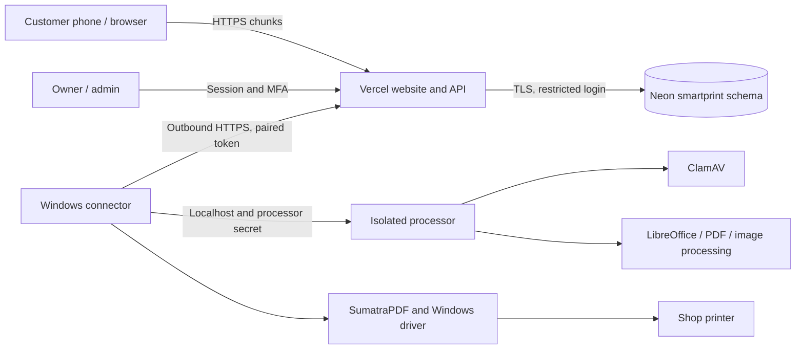

# Architecture and data design

Updated 23 October 2026. Target: Vercel + Neon + always-on shop PC.

## Components

Vercel runs no scanner, converter or printer driver. Customers upload encrypted chunks; a shop device prepares output. Binary chunks are limited to 1 MiB (about 1.4 MiB base64), below Vercel's documented payload limit. Large PDFs use bounded Range responses. Native processing dependencies are excluded from the function bundle; browser PDF.js assets are static.

## Data model

| Tables | Purpose |
|---|---|
| users, shops | Email, salted password hash, role; one shop per owner, prices in paise, approval and price version |
| sessions, mfa, rate_limits | Hashed eight-hour sessions, encrypted authenticator secrets, replay counters and shared limits |
| shop_payments, upi_receipts | Shop UPI settings and immutable payee snapshot per order |
| uploads, upload_chunks | Temporary encrypted chunks, filename, size and expiry; chunks cascade on deletion |
| preparations | Input IDs, settings, device assignment and short expiry |
| documents | AES-GCM encrypted prepared PDF in BYTEA, nonce/tag and 24-hour expiry |
| quotes | Token digest, pages/sides/sheets, price, options, expiry and one-use flag |
| orders | Receipt token digest, independent payment/print states, immutable price and deletion timestamp |
| transactions, refunds | One collection per order; separate refund without deleting collection |
| devices, print_leases | Revocable token hashes, capabilities, heartbeat and one-time submission state |
| audit, worker_status | Content-free actions and last successful cleanup |

All app SQL targets `smartprint`. Production requests never migrate or seed demo users. Runtime grants are limited to table CRUD; migrations use an operator login. Sessions survive function restarts and multiple instances.

## File lifecycle

1. Active-shop upload handles expire in 30 minutes. New uploads are limited by a 200 MiB per-shop temporary-storage reservation.
2. An online paired device claims preparation. At most 20 queued/processing preparations are allowed; the same input cannot be queued twice while active.
3. The processor scans, converts if necessary and normalizes to A4. Original chunks are deleted when the result and quote commit. Failed preparation deletes its chunks.
4. Customer previews the exact PDF and accepts a 15-minute one-use price quote.
5. Verified payment releases a compatible print claim. Downloads need device and lease tokens. Submission is accepted once.
6. Owner confirmation commits completion, deletes PDF and lease, and audits deletion atomically. Receipt metadata remains.
7. Expired documents become inaccessible immediately. Physical cleanup runs on connector heartbeats, local timers, function initialization and daily Vercel cron fallback. During a total worker outage, expired bytes remain until cleanup resumes.

## Printer and payment behavior

The connector journals submission before invoking SumatraPDF. It removes downloaded PDFs in a finally block and stale PDFs on startup. Ambiguous results require owner review and never trigger automatic reprint. Before marking a failed job stopped, the owner checks paper and cancels any remaining Windows queue job.

UPI QR/intent points to the shop's chosen account. Customer reports remain pending until the owner checks their own bank credit. Cash uses an owner collection gate. Refund recording confirms money already returned; it does not send funds. The legacy optional Razorpay adapter is disabled and outside this release's validated payment path.

## Updates, scaling and recovery

Customer tracking and owner data poll every five seconds while visible and not editing a form. The connector polls work every five seconds and heartbeats every 30 seconds, even during processing. Older than 90 seconds means offline. Cash support does not imply operation without Internet.

Bounded encrypted files live in Neon as requested. At larger scale, private object storage can replace BYTEA while retaining authorization and deletion semantics. Load, storage cost and concurrent-shop capacity must be measured. SQL deletion does not erase historical backups; shared encryption is not per-document cryptographic erasure.

References: [Vercel limits](https://vercel.com/docs/functions/limitations), [function configuration](https://vercel.com/docs/project-configuration/vercel-json), [Neon connections](https://neon.com/docs/get-started/connect-neon), [SumatraPDF](https://www.sumatrapdfreader.org/docs/Command-line-arguments).
