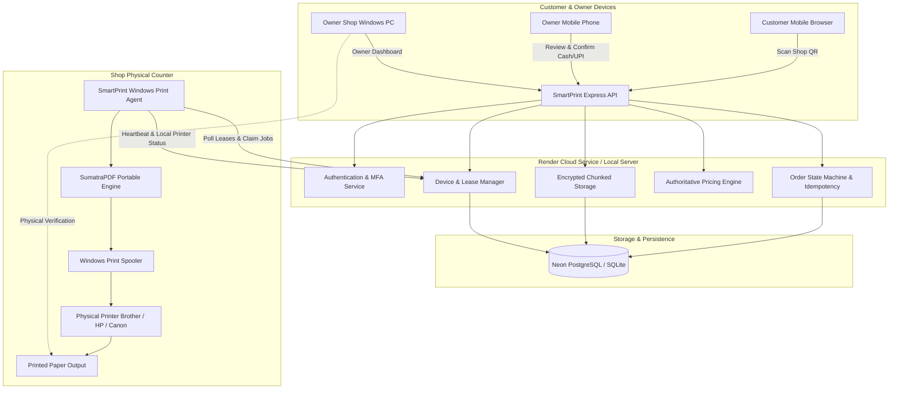

# SmartPrint — Architecture Audit & Existing System Inventory

## 1. Executive Summary

SmartPrint is an on-demand, contactless web printing management platform designed for campus and commercial print shops. Customers scan a shop-specific QR code at the counter, upload documents (PDF, JPG, PNG), configure print options (B&W/Colour, single/two-up/card layout, duplex, copies, page ranges), receive authoritative pricing, and pay via Cash or Direct UPI. The shop owner manages incoming orders, validates payments, pairs local Windows printers via an automated background agent (Windows Print Connector), and oversees physical print fulfillment. Platform administrators manage shop registrations, access approvals, pricing rules, and platform security audits.

This audit maps the actual discovered technology stack, data flow, deployment infrastructure, hardware integration, and gaps between local development and production hosting on Render.

---

## 2. Technology Stack & Component Inventory

| Component | Discovered Technology | Version / Configuration | Notes |
| :--- | :--- | :--- | :--- |
| **Frontend Framework** | Vanilla ES Modules (Pure Web Components) | ES2022+ | Zero client bundling; uses native browser features, Fetch API, and standard DOM. |
| **Styling & UI** | Pure CSS (Custom Design System) | `premium.css`, `style.css` | High-contrast, responsive layout for mobile and desktop dashboards. |
| **Backend Runtime** | Node.js | v24.x (active in `package.json` engines) | Native Node.js test runner (`node --test`), native crypto, native fetch. |
| **Web Server Framework** | Express.js | `^5.1.0` (ESM module mode) | Strict CSP headers, rate-limiting, CORS, cookie session auth. |
| **Database Engine** | PostgreSQL (Neon serverless) / SQLite (local fallback) | `pg ^8.16.3` / `node:sqlite DatabaseSync` | `smartprint` schema in Postgres; local SQLite in `.data/smartprint.sqlite`. |
| **Document Processing** | `pdf-lib`, `sharp`, `@napi-rs/canvas`, `pdfjs-dist` | `pdf-lib ^1.17.1`, `sharp ^0.35.5`, `pdfjs-dist ^6.4.299` | Page layout, 2-up imposition, card normalization, image cropping. |
| **Security & Cryptography** | Node.js `node:crypto` | AES-256-GCM, scrypt, SHA-256, HMAC-SHA1 TOTP | Files encrypted at rest in DB payload chunks; TOTP MFA. |
| **QR Code Generation** | `qrcode` | `^1.5.4` | Server-side and client-side data URL generation. |
| **Windows Print Agent** | Standalone Node.js Agent + SumatraPDF | `connector/index.js`, `connector/sumatra-helper.js` | Direct Windows registry scanning, spooler submission via SumatraPDF. |
| **Cloud Deployment** | Render Web Service | `render.yaml` (free tier web service) | Node.js runtime, HTTPS termination, auto-deploy from `main`. |
| **CI / Automation** | GitHub Actions | `.github/workflows/ci.yml` | Multi-OS verification (`ubuntu-latest`, `windows-latest`). |

---

## 3. End-to-End System Architecture

---

## 4. Key Architectural Discoveries & Risk Assessment

1. **Dual Database Architecture:**
   - Production uses Neon PostgreSQL with connection pooling and SSL mode (`sslmode=verify-full`).
   - Development gracefully falls back to local SQLite WAL mode (`.data/smartprint.sqlite`) when `DATABASE_URL` is unconfigured or unreachable.
   - SQL queries are dynamically qualified to `smartprint.<table_name>` for PostgreSQL and unmodified for SQLite.

2. **Zero-Knowledge Document Storage:**
   - Customer files are broken into 1 MB chunks and encrypted with AES-256-GCM using `FILE_ENCRYPTION_KEY` before persistence.
   - Documents are automatically purged from database tables upon confirmed physical print completion or after document expiry.

3. **Decoupled Shop PC Print Agent:**
   - The cloud server (Render) runs on Linux containers with no physical printer access.
   - The Windows Print Agent runs locally on the shop's Windows PC, securely polling the cloud backend using a unique hashed device token (`devices` table).
   - Remote owner approvals from mobile browsers travel to the cloud DB; the local Windows agent claims the lease, retrieves the encrypted PDF, and delivers it to the local Windows spooler via SumatraPDF.

4. **Idempotency & Concurrency Deficits (Addressed in Phase 4-5):**
   - Previously, rapid double taps on "Place Order" or "Collect Cash" could fail with 409 or create redundant transactions.
   - Missing centralized state machine permitted ad-hoc status queries across UI routes.
   - A dedicated idempotency layer with persisted keys and atomic status transitions was required to protect financial and printing workflows.
