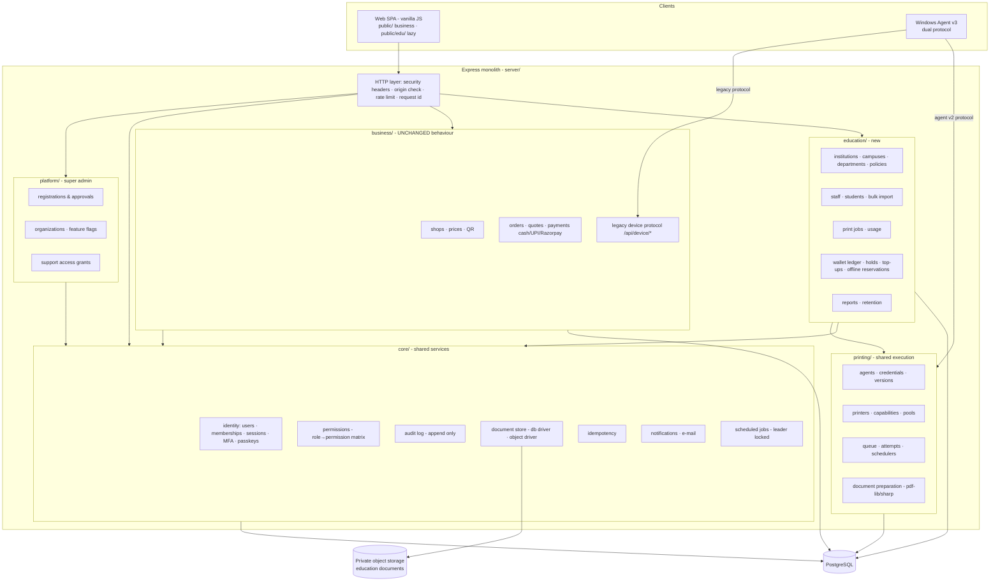

# 02 · Smart Print Architecture Blueprint

All items are **[R]** (design proposals) unless tagged otherwise. Facts about today's code are in [01](01-existing-project-technical-audit.md).

## 1. Architecture decision

**Chosen: a modular monolith on the existing Express/PostgreSQL stack, plus a dual-protocol Windows Agent.** No microservices, no framework rewrite.

| Option | Verdict | Reasoning |
|---|---|---|
| Microservices (auth, wallet, queue, …) | Rejected | One small team, one database, ~90 endpoints, strongly transactional flows (wallet hold + job enqueue). Network boundaries would add failure modes without isolating anything the team cannot isolate with module rules. |
| Keep ad-hoc monolith (route handlers hold business logic) | Rejected | Adding ~30 tables and 4 new roles to `server/index.js` would make regression in the live Business flow likely. |
| **Modular monolith** | **Chosen** | One deployable, one transaction scope, enforced module boundaries (imports only through each module's `index.js`), per-module tests, can extract a module later (wallet or queue) if load demands. |
| Rewrite frontend in React/Next | Rejected for now | Not needed for any requirement; large regression surface for Business UI. Add a lazy-loaded `public/edu/` area instead. |

### Guardrails
1. **Additive-only changes to Business tables** until Education is stable (expand → migrate → contract, [16](16-risk-assessment-and-rollback-plan.md)).
2. **Business endpoints under `/api/*` are a frozen contract** (called "v1"). New capabilities live under `/api/v2/*`.
3. Feature flags per organization (`organizations.features`) gate every new surface; default off.
4. PostgreSQL becomes the **only** supported database for new modules (dev via local Postgres container); SQLite stays only for the legacy Business tests until Phase 1 moves CI to PostgreSQL.

## 2. Target module map



### Dependency rules (enforced by an import-lint test)
- `business/` and `education/` **never import each other**.
- Both may import `core/` and `printing/` (through their public index).
- `printing/` imports `core/` only; it knows jobs by an abstract `JobSource` contract, not by `orders` or `print_jobs`.
- `platform/` may read organizations of both types but not their money or documents.

## 3. Shared versus separate

| Concern | Shared infrastructure | Strictly separate |
|---|---|---|
| Identity | `users`, sessions, MFA, passkeys, `memberships` | role vocabulary per org type |
| Tenancy | `organizations` root table | org-owned data tables per domain |
| Printing | Agent binary, printer discovery, capability probe, `prepare()` | Business: `orders`+`print_leases`; Education: `print_jobs`+`print_attempts` |
| Money | none | Business: `transactions/refunds` (cash/UPI/Razorpay); Education: wallet ledger. **Financial rows never share tables.** |
| Documents | `DocumentStore` interface | Business keeps BYTEA driver; Education uses object storage |
| Audit | `audit_log_v2` (org-scoped) | Business keeps legacy `audit`, mirrored forward |

## 4. Runtime topology

| Component | Today | Target |
|---|---|---|
| Web/API | Render web (free), single instance | Same service, paid always-on instance; stateless (all in-memory control state moved to PostgreSQL) so ≥2 instances are safe |
| Scheduler | `setInterval` inside web | `jobs/` module with `pg_try_advisory_lock` leader election; optional separate worker process using the same image |
| Database | Neon, pool max 5 | Neon (or managed PG) with PgBouncer-compatible `SET LOCAL` use; pool sized per instance; read-only role for reports |
| Document storage | BYTEA | Business unchanged; Education → S3-compatible private bucket (e.g. R2/S3/GCS) with envelope encryption |
| Agent | Node script, one printer | Windows service, multiple printers, local SQLite queue, signed auto-update, dual protocol |
| Observability | stdout JSON log, `/readyz` | Central log sink, error tracker, metrics (`/metrics` internal), agent/printer health dashboards, alerting |

## 5. Request lifecycle (new modules)

```
HTTP → request id → security headers → origin/CSRF check (browser routes) → rate limit
     → session → resolve active membership (org_id, role, permissions)
     → permission guard  requirePermission('printers.manage')
     → handler → service (business rules) → repository  withTenant(org_id, tx)
     → audit (same transaction) → response
```
`withTenant` runs `SET LOCAL app.org_id = …` inside the transaction so PostgreSQL row-level security applies as a **second** line of defence behind explicit `org_id` predicates ([07](07-database-er-diagram.md), [11](11-security-and-document-retention-plan.md)).

## 6. Code layout (proposed, applied incrementally)

```
server/
  app.js                 # composition root (replaces most of index.js over time)
  platform/  core/  printing/  business/  education/
  db/migrations/0001_baseline.sql …   # versioned SQL, schema_migrations table
  db/tenant.js           # withTenant()
test/
  business-regression/   # golden-path suite that must stay green on every PR
  education/  printing/  security/  load/
public/ (unchanged)  public/edu/ (new, lazy-loaded modules)
connector/ → agent/      # v3, keeps connector/ entrypoint for existing installs
```
`server/index.js` shrinks by **moving** handlers into `business/` unchanged (mechanical refactor guarded by the regression suite), not by rewriting them.

## 7. Cross-cutting standards

- Money: integer minor units (`BIGINT`), currency column, never floats.
- Time: `timestamptz` for all new tables; UTC only; server clock is the only authority for leases and expiries.
- IDs: UUIDv7 (time-ordered) for new tables.
- Every org-owned table: `org_id NOT NULL`, composite FK `(org_id, id)` for cross-references, index starting with `org_id`.
- Errors: `{ error: { code, message, request_id } }` for v2; v1 keeps `{ error: "message" }`.
- Idempotency: required header on every v2 money or job-creating POST ([10](10-wallet-payment-offline-architecture.md)).
- Audit: written in the same transaction as the change; append-only.

## 8. What stays exactly as it is

Customer upload/crop/preview UI, shop owner dashboard, cash/UPI/Razorpay flows, `/api/device/*` protocol, lease/uncertain-output semantics, SumatraPDF engine, QR posters, MFA/passkey screens, `unique_upi_collection`, receipt-token customer model. Any change to these requires an explicit entry in the roadmap with a regression gate.
