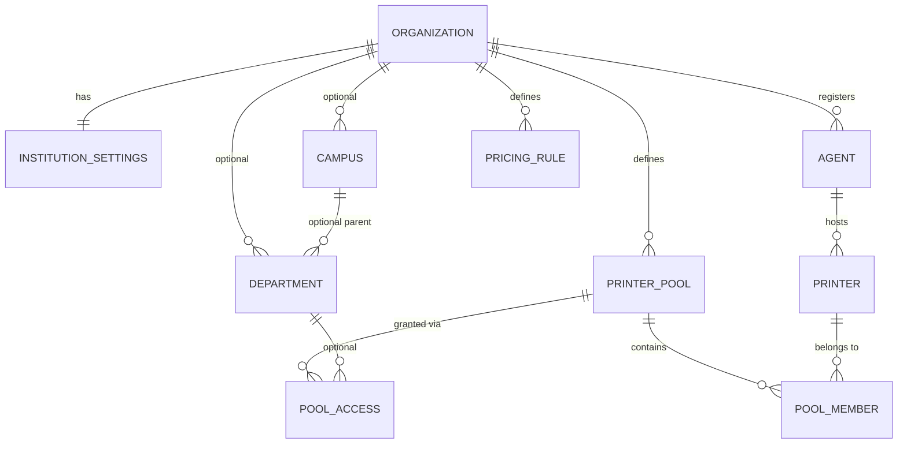

# 04 · Flexible Institution Configuration Design

Design goal: **the same data model and code path serve a one-printer college and a multi-campus university.** Nothing is mandatory except an organization, an Institution Admin and (to print) one printer reachable by one agent. All items **[R]**.

## 1. Principles

1. **Zero required hierarchy.** Campuses and departments are optional layers. If none exist, every user belongs directly to the institution.
2. **Defaults are materialised once, silently.** On activation the system creates (a) a *Default pool* and (b) nothing else. No wizard step creates campuses, departments or agents.
3. **Pools decouple people from printers.** Users/departments gain access to *pools*; a pool contains printers. One printer for everyone is one pool with one member; ten departments sharing it all point to the same pool.
4. **Progressive disclosure.** The Institution Admin UI shows only configured concepts; "Add departments", "Add campus", "Add another agent" are buttons, not steps. Every structure can be added later without migrating data (rows reference the optional parent with `NULL` meaning "institution level").
5. **Everything reversible.** Printers, agents, departments are deactivated (soft state), never hard-deleted; reassignment is an audited action.
6. **No hard-coded counts.** No minimum/maximum number of departments, printers or agents in code; only sanity limits stored as per-org settings (e.g. `max_printers`, adjustable by Super Admin).

## 2. Configuration model

| Table | Key columns | Optionality |
|---|---|---|
| `institution_settings` | `org_id`, `policies jsonb`, `version` (optimistic lock) | one row per org |
| `campuses` | `org_id`, `name`, `status` | optional; `campus_id` is nullable everywhere |
| `departments` | `org_id`, `campus_id NULL`, `name`, `code`, `status` | optional |
| `agents` | `org_id`, `campus_id NULL`, credentials, `version`, `last_seen_at` | ≥1 needed to print |
| `printers` | `org_id`, `agent_id`, `windows_name`, capabilities, `connection_class` (`usb`/`network`), `status` | ≥1 needed to print |
| `printer_pools` | `org_id`, `name`, `scheduler`, `is_default` | Default pool auto-created |
| `pool_members` | `pool_id`, `printer_id`, `priority` | |
| `pool_access` | `pool_id`, `department_id NULL`, `audience` (`all`/`staff`/`student`), `campus_id NULL` | no rows ⇒ default pool open to everyone in the org |
| `pricing_rules` | `scope` (`institution`/`department`/`printer`), `scope_id NULL`, `audience`, colour/BW per side, duplex rule, effective dates | institution-level rule is mandatory only for students |

### Resolution rules (deterministic)
- **Which pool does a job use?** The first `pool_access` match in this order: user's department → user's campus → institution. If none match, the default pool. If the default pool has no online printer able to satisfy the job, the submit is rejected with a clear message (no silent queueing for impossible jobs).
- **Which price applies?** Most specific rule wins: printer → department → institution; audience-specific beats `all`.
- **Which printer within a pool?** The scheduler picks among printers that are *active, online, capability-compatible, and bound to a reporting agent*; departments never override capability.

## 3. Preset topologies (the same schema, different rows)

| Scenario | Departments | Pools | Printers | Agents | Notes |
|---|---|---|---|---|---|
| **A. Small college**: one admin, one printer | none | 1 default | 1 | 1 | Setup: register → approve → install agent → print. Staff and students in a flat list; Department Admin role never appears. |
| **B. One printer shared by several departments** | 4 | 1 default (all four have access, or none specified) | 1 | 1 | Departments exist for reporting/HOD only; usage reports split by department. |
| **C. Department-owned printers** | 6 | 6 (one per dept) + 1 shared "Library" | 7 | 2–3 | `pool_access` limits each department to its pool; the Library pool is open to all. |
| **D. Several printers in one department** | 1 | 1 pool with 3 members | 3 | 1 | WFQ/FIFO across the pool; colour jobs go only to the colour member. |
| **E. Multi-campus university** | 30 | per-campus pools + shared pools | 40+ | 10+ | `campus_id` on agents/printers/departments; campus admins are Department-Admin-style roles scoped to a campus [future]. |
| **F. Network printer served by two agents** | any | any | 1 (`connection_class=network`) | 2 | Both agents are *eligible*; fencing guarantees one print ([09](09-print-queue-and-agent-architecture.md)). USB printers are bound to exactly one agent. |

## 4. Growth path (nothing to migrate)

| Step | Operation | Data impact |
|---|---|---|
| Start | Create org; default pool auto-created | 2 rows |
| Add a second printer | Register on same agent, add to default pool | 2 rows |
| Introduce departments | Create departments, assign users (bulk edit), optionally create pools/access | users get `department_id`; jobs created earlier keep `department_id NULL` |
| Dedicated printers | Move printer to a new pool, grant department access | 1 `pool_members` change, audited |
| Second agent/campus | Register agent with `campus_id`, assign printers | `printers.agent_id` change (reassignment API) |
| Shrink | Deactivate department/printer/agent | `status='inactive'`; history preserved; pending jobs reroute or wait per setting |

## 5. Institution policy settings (`institution_settings.policies`)

| Group | Settings (all with defaults, per-org, versioned, validated by JSON Schema) |
|---|---|
| Printing | allowed file types, max pages/job, max copies, colour allowed (students/staff), duplex default, release-at-printer (`off`/`optional`/`required`), allow printing without department |
| Queue | scheduler per pool, class weights (staff:student), aging rate, per-user queued-job cap, max wait target |
| Pricing | currency (INR), rounding, minimum job amount, free monthly pages per student (optional) |
| Wallet | min top-up, max balance, low-balance alert, refund-to-wallet vs original-method policy, expiry (default none) |
| Offline | allow offline staff printing, allow offline student printing, max reservation per student, reservation expiry hours, max reservation per agent |
| Retention | document retention after print (0 h–30 d), failed-job document retention, report/audit retention, anonymise-after-N-years |
| Security | MFA required for admins (always), for staff (optional), password policy, session idle timeout, allowed login methods (password, SSO later) |
| Departments | `require_department` (default false), HOD approval for departmental quota changes (default off) |

Every settings change is audited with before/after and bumps `version`; agents fetch effective settings with their ETag.

## 6. Admin operations and guardrails

| Operation | Allowed to | Guardrail |
|---|---|---|
| Add / edit / deactivate / reassign printer | Institution Admin | Cannot deactivate the last printer of the default pool while jobs are queued without choosing *reroute* or *hold*; reassignment of a USB printer shows "agent must physically host it" confirmation |
| Add / revoke / rotate agent credential | Institution Admin | Revocation takes effect on the agent's next request; in-flight lease goes `uncertain`, never auto-retried |
| Create / merge / deactivate department | Institution Admin (Department Admin edits own metadata only) | Users of a deactivated department fall back to institution level |
| Change policies | Institution Admin | Versioned, audited, previewable "effective settings" view |
| Bulk user import | Institution Admin (Dept Admin for own department) | Dry-run, row-level error report, duplicate College ID rejection, forced password reset on first login |

## 7. Why this works at both ends

- **Small college** touches 4 tables (`organizations`, `institution_settings`, `printer_pools` default row, one agent+printer) and 0 optional screens.
- **Large university** uses the *same* tables with more rows plus `campus_id`/`department_id` filters; scaling is index-driven (`(org_id, pool_id, status)` for the queue; `(org_id, department_id)` for reports), not schema-driven.
- Because routing is by **pool**, re-organising departments or moving printers is data change, not code or migration change.
