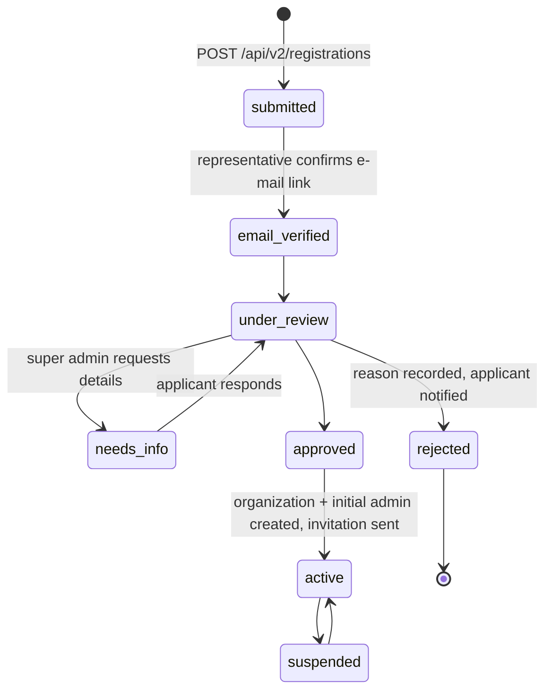
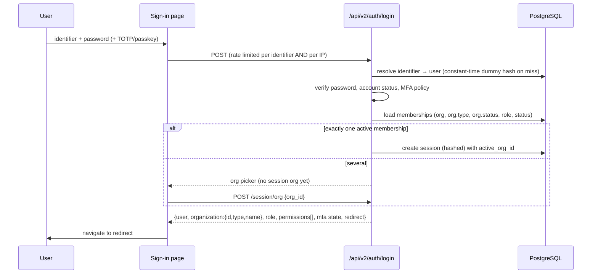

# 05 · Unified Registration and Authentication Flow

## 1. Starting point **[V]**

- `#register` registers **shops only** (`POST /api/auth/register`: creates `users(role=owner)` + `shops(status=pending)` in one transaction; owner can sign in and configure while pending; the shop cannot take orders until a platform admin sets `active`).
- `#login` is already a single sign-in for all existing roles: `POST /api/auth/login` (email + password, TOTP/recovery code) or passkey; the front end redirects by role (`admin→#admin`, `owner→#owner`).
- Admin accounts are created only by `scripts/provision-admin.js`; admin MFA is mandatory in production.
- No e-mail delivery exists; no rejection state; no password-reset; no organization concept.

So the request is an **extension**, not a new system. The proposal keeps the existing endpoints working byte-for-byte and adds v2 behind them.

## 2. Registration (common entry page) **[R]**

One page, one wizard, organization type selected first.

| Step | Business | College / University |
|---|---|---|
| Organization details | shop name, location, contact | legal name, institution type, affiliation/registration number, address, campuses count (informational), website domain |
| Authorized representative | owner name, phone | name, designation, official e-mail (domain check against website advisory), phone |
| Initial administrator | the owner (same person) | Institution Admin name + e-mail (may equal representative) |
| Anti-abuse | rate limit, e-mail verification, CAPTCHA/Turnstile **[A: needs provider decision]** | same + document upload (authorization letter) optional |
| Result | `organizations(type=business)` + `shops` row (compatible with today) | `organizations(type=education)` + `institution_settings` + default pool |

### Rules
1. Registration creates **no usable account** for education until approval. For business, current behaviour is preserved (sign-in allowed while pending; ordering blocked) so existing owners are not surprised.
2. E-mail verification precedes review (prevents reviewing junk).
3. Approval is performed only by a Platform role with `registrations.review`; the decision, reviewer and reason are written to `audit_log_v2` and stored on the registration.
4. On approval, in **one transaction**: create organization, institution settings, default pool, initial admin membership; create a single-use, 72-hour invitation token (hashed in DB). The admin sets their own password through the invitation link – **no password is ever generated or e-mailed**.
5. Rejection is final for that application; a new application may reference the old one.
6. Existing `/api/auth/register` is retained and internally calls the same service with `type=business`.

**Dependency:** an e-mail provider (SES/Resend/SMTP) and templates are required – none exists today. This is the first unresolved decision (#1 in [17](17-final-recommended-architecture.md)).

## 3. Sign-in **[R]**

### Identifiers
| Population | Login identifier | Scope of uniqueness |
|---|---|---|
| Platform admin, business owner, staff with e-mail, institution/department admin | e-mail | global (`users.email`, unchanged) |
| Student | **Institution code + College ID / Roll number** | unique per organization (`user_identifiers(org_id, kind='college_id', value)`) |
| Staff without e-mail | Institution code + staff ID | per organization |

Because students' IDs are not globally unique, the entry page offers two inputs: **E-mail or "Institution code + ID"**, and institutions get a branded deep link `/i/<slug>` that pre-fills the code (what most colleges will share). `users.email` is relaxed from `NOT NULL` to nullable (additive, unique allows many NULLs) with a CHECK that a user has an e-mail or at least one identifier.

### Flow

### Server decision table (after authentication)
| Condition | Result |
|---|---|
| user `status` ∈ {suspended, disabled} | 403, no session |
| organization `status` ≠ `active` | 403 "Organization pending/suspended" (business owners in `pending` keep today's limited access) |
| membership `status` ≠ `active` | membership ignored |
| MFA required by policy and not satisfied | session created in "MFA required" state (as today `mfaRequired`) and only security endpoints work |
| role = `platform_*` | redirect `#admin` |
| org.type = business, role = owner | redirect `#owner` (unchanged) |
| org.type = education | redirect by role: `institution_admin → #edu/admin`, `department_admin → #edu/department`, `staff → #edu/print`, `student → #edu/print`, `print_operator → #edu/queue` |

`GET /api/me` (v1) keeps returning today's shape; `GET /api/v2/me` returns the extended shape. The v1 login response gains optional fields only (additive).

### Session design
- Same hashed-cookie model (`sp_session`, `HttpOnly`, `SameSite=Lax`, `Secure`).
- Add `sessions.active_org_id`, `last_seen_at` (idle timeout, default 30 min for admins, 8 h for students), `user_agent`, `ip_hash`; session list + "sign out everywhere".
- Privilege changes (role change, suspension, password change, MFA change) delete the user's sessions (already true for password/MFA today).
- Sessions of education users cannot call `/api/owner/*`; business owners cannot call `/api/v2/edu/*`: enforced by permission guard, not by route naming.

### Account lifecycle
| Event | Behaviour |
|---|---|
| Bulk import | Creates `invited` accounts with a **one-time activation link or temporary password flagged `must_change`**; no reusable default password |
| First login | Force password set; optional MFA enrolment prompt |
| Forgot password | E-mail reset link (single-use, 30 min) or institution admin reset for students without e-mail; every reset audited, sessions revoked |
| Student leaves | Admin sets `graduated`/`disabled`; wallet balance handled by refund policy ([10](10-wallet-payment-offline-architecture.md)) |
| Lockout | Per-identifier **and** per-IP throttle with exponential delay instead of hard lock (fixes the lock-out-by-attacker weakness S7) |
| Optional later | Google/Microsoft SSO via OIDC per institution; SCIM/CSV sync for ERP |

## 4. Super Admin boundary

Platform roles are separate from organization roles and never appear in `memberships`.

| Platform role | Can | Cannot |
|---|---|---|
| `platform_owner` | everything below + create platform staff | – |
| `platform_reviewer` | review registrations, activate/suspend orgs, read org metadata | read documents, wallet details, users' personal data |
| `platform_support` | read org configuration, agent/printer health, request support access | open documents or wallets unless an approved, time-limited grant exists |
| `platform_security` | read global audit, revoke sessions/credentials | change org data |

Existing `users.role='admin'` maps to `platform_owner` at cut-over (no behaviour change); finer roles are added later. Platform accounts require MFA always and cannot be created through any API.

## 5. Compatibility checklist (Business must not notice)

| Existing behaviour | Preserved by |
|---|---|
| `POST /api/auth/login` body/response, `role` hint | v1 handler untouched; org fields appended |
| Owner can log in while shop `pending` | Business orgs keep this rule |
| Admin approves via `POST /api/admin/shops/:id/status` | Endpoint kept; internally updates `shops.status` **and** `organizations.status` in one transaction (dual-write during transition) |
| Cookie name, TTL (8 h), MFA enforcement for admins | unchanged defaults |
| `#login` / `#workspace` URLs | unchanged |
