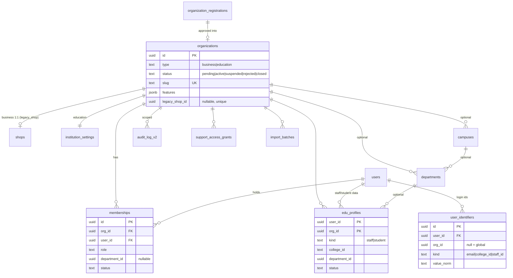
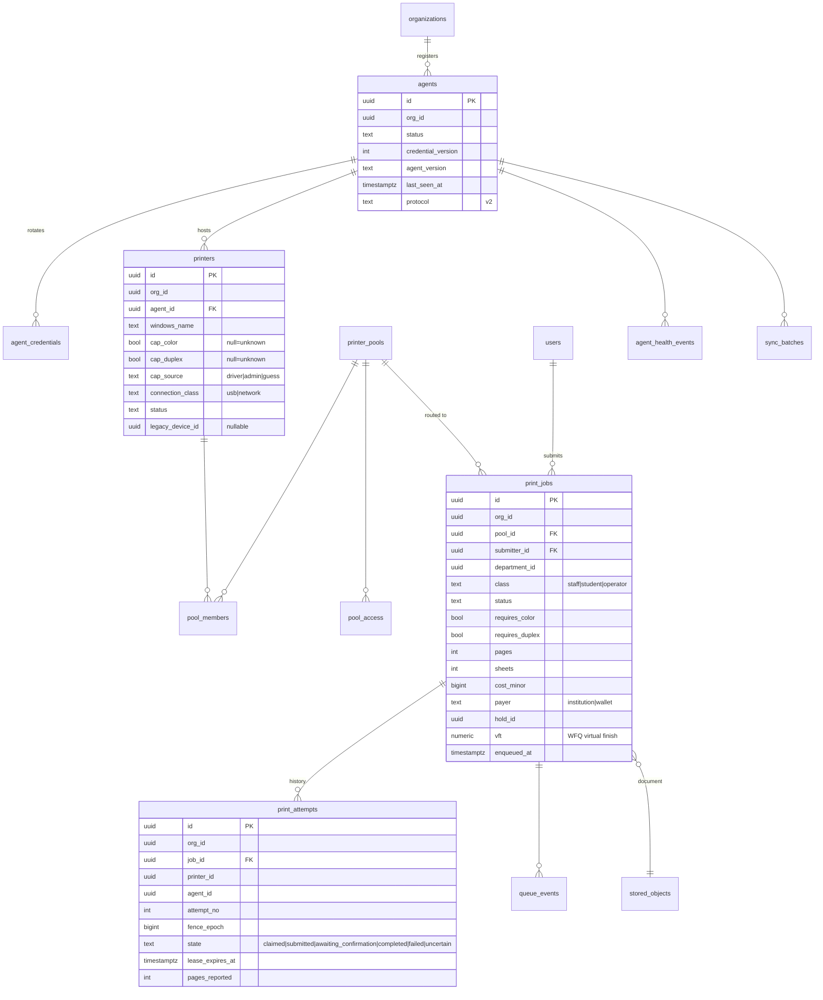
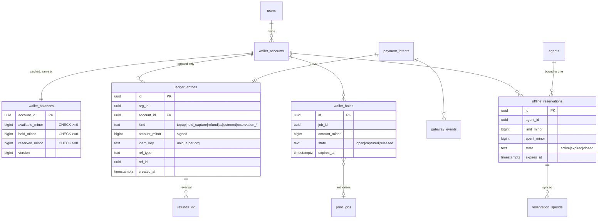

# 07 · Database Design and ER Diagram

Existing tables are **frozen** (additive columns only). All new tables below are **[R]**. Conventions: `uuid` PKs (v7), `org_id uuid NOT NULL` on every org-owned table, `timestamptz`, `BIGINT` minor-unit money, `jsonb` for validated documents only (never for queried fields).

## 1. Logical ER – platform, identity, structure

## 2. Logical ER – printing

## 3. Logical ER – money (Education only)

## 4. Tenant-isolation design

| Control | Detail |
|---|---|
| **Column** | Every org-owned row has `org_id NOT NULL`; no nullable tenant keys except explicitly global tables (`users`, `schema_migrations`). |
| **Composite foreign keys** | Children reference `(org_id, id)` of parents (e.g. `print_jobs(org_id,pool_id) → printer_pools(org_id,id)`), so a row can never point at another org's parent even if app code is wrong. |
| **Repository contract** | New code accesses data only through `withTenant(org_id, tx => …)`; raw `db.query` is lint-forbidden outside `core/db`. |
| **Row-Level Security** | `ALTER TABLE … ENABLE/FORCE ROW LEVEL SECURITY`; policy `USING (org_id = current_setting('app.org_id')::uuid)`. `withTenant` issues `SET LOCAL app.org_id` inside the transaction (safe with PgBouncer transaction pooling). The application role is **not** the table owner and has no `BYPASSRLS`. Platform jobs use a separate role that can only read aggregate views. |
| **Frontend filters are not security** | Every v2 route resolves org from the session membership, never from a request parameter; tests send forged `org_id`/ids of another org and expect 404. |
| **Agents** | Agent credential → `agents.org_id`; every claim/event query adds `org_id = agent.org_id`. |
| **Legacy Business tables** | Keep the current `shop_id` predicate pattern (`ownerShop`, `ownerOrder`); RLS for them is deferred (would need `org_id` on `orders` etc.) and tracked as a later hardening item. Tests already assert cross-shop 404s. |
| **Search/reports** | Aggregates are views that group by `org_id`; the platform role sees only views. |
| **Storage** | Object key prefix `org/<org_id>/…`; IAM policy of the app is bucket-wide, so the **per-org data key** (not the path) is what isolates ciphertext. |

## 5. Constraints (highlights)

| Table | Constraint |
|---|---|
| `organizations` | `CHECK (type IN ('business','education'))`; unique slug; immutable `type` via trigger |
| `memberships` | `UNIQUE (user_id, org_id, role, COALESCE(department_id, ‘0000…’))`; role CHECK against allowed set per org type (trigger joins `organizations.type`) |
| `edu_profiles` | `UNIQUE (org_id, kind, college_id)` |
| `user_identifiers` | `UNIQUE (COALESCE(org_id,'0000…'), kind, value_norm)` |
| `printers` | `UNIQUE (org_id, agent_id, windows_name)`; `CHECK (connection_class IN ('usb','network'))` |
| `pool_members` | PK `(pool_id, printer_id)`; both same `org_id` by composite FK |
| `print_jobs` | status CHECK; `CHECK (pages > 0)`; partial index `(org_id, pool_id, vft) WHERE status='queued'` |
| `print_attempts` | **`UNIQUE (job_id) WHERE state IN ('claimed','submitted','awaiting_confirmation','uncertain')`** – at most one live attempt per job; `UNIQUE (job_id, attempt_no)` |
| `ledger_entries` | `UNIQUE (org_id, idem_key)`; insert-only (trigger rejects UPDATE/DELETE; `REVOKE UPDATE, DELETE`); `amount_minor <> 0` |
| `wallet_balances` | `CHECK (available_minor >= 0 AND held_minor >= 0 AND reserved_minor >= 0)` |
| `offline_reservations` | `CHECK (spent_minor <= limit_minor)`; one active reservation per (account, agent) |
| `reservation_spends` | PK `(agent_id, seq)` – replay-safe sync |
| `gateway_events` | `UNIQUE (provider, event_id)` |
| `audit_log_v2` | insert-only; optional per-org hash chain (`prev_hash`,`hash`) for tamper evidence |

## 6. Key indexes

`print_jobs (org_id, pool_id, status, vft)` partial on queued · `print_jobs (org_id, submitter_id, created_at DESC)` · `print_attempts (agent_id, state)` partial live · `ledger_entries (org_id, account_id, created_at DESC)` · `edu_profiles (org_id, department_id)` · `queue_events (org_id, job_id, created_at)` · `agents (org_id, status, last_seen_at)` · `audit_log_v2 (org_id, created_at DESC)` · `stored_objects (org_id, expires_at) WHERE deleted_at IS NULL` (retention sweeper).

## 7. Existing-table changes (all additive, nullable, defaulted)

| Table | Change | Purpose |
|---|---|---|
| `shops` | `organization_id uuid NULL` → backfilled → later `NOT NULL` | link to org |
| `users` | `email` → nullable; `status` unchanged | students without e-mail |
| `sessions` | `active_org_id`, `last_seen_at`, `user_agent` | org context, idle timeout |
| `devices` | `paused boolean NOT NULL DEFAULT false`, `paused_note text` | persist pause (fixes P1) |
| `orders` | none in first phases (priority/attempt stay in JSON until a later Business-hardening phase) | protect Business |

## 8. Migration strategy

1. **Introduce `schema_migrations`** (version, checksum, applied_at) and a baseline migration equal to today's schema (idempotent `CREATE IF NOT EXISTS` so it is a no-op on production).
2. Migrations are **versioned SQL files**, applied by a dedicated deploy step using the **owner** role (`MIGRATION_DATABASE_URL`); the web process only *verifies* `schema_migrations` and refuses to start (or goes read-only) if behind – ending silent, swallowed DDL.
3. Remove the table-name regex: set `ALTER ROLE app SET search_path = smartprint` and write unqualified SQL in new code; legacy code keeps `qualify()` until Phase 1 removes it with tests.
4. **Expand → backfill → contract**: add nullable column/table → dual-write → backfill in batches → switch reads → only then add NOT NULL / drop old. No migration in the first release of a phase may drop or rename a Business column.
5. Each migration ships with a **down** note (usually "leave additive objects in place") and is rehearsed on a restored production snapshot in staging before production.
6. Backfill `organizations` from `shops`: one transaction per shop; idempotent via `legacy_shop_id` unique; verify counts (`shops = business orgs`) before enabling dual-write.
7. `devices → agents+printers` backfill likewise via `legacy_device_id`; the legacy `/api/device/*` keeps reading `devices`; the adapter writes both.
8. Large data (documents) never moves during a migration; new Education documents use the new store from day one.

## 9. Existing record handling

Existing shops, owners, orders, transactions and devices remain in place and keep their ids. **[U]** The size and content of the production database were not inspected; before Phase 2 a read-only census (row counts, orphan documents, shops with no owner, duplicate emails differing by case) is required.
