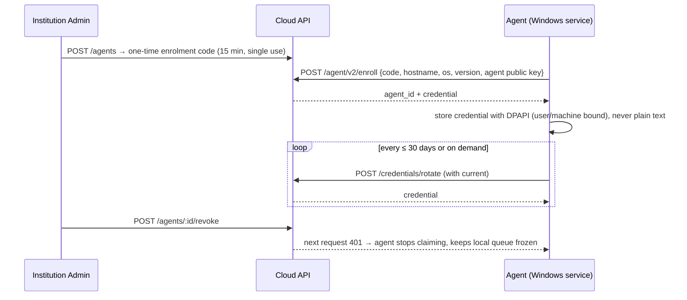
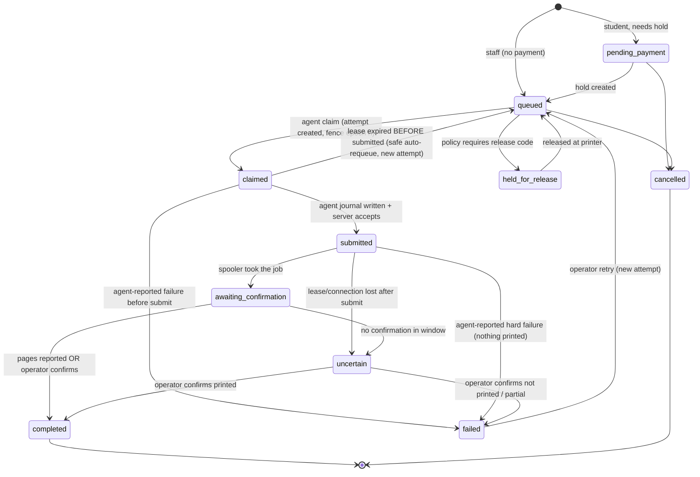

# 09 · Print Queue and Windows Agent Architecture

## 1. Current state (**[V]**) and what is kept

Kept as proven: lease states `claimed → submitted → awaiting_confirmation`, **journal-before-submit**, conservative `uncertain → needs_review` on expiry, retry only after a device-reported failure, cancel races resolved by the order row lock, capability filtering at claim time, spooler watcher that removes jobs the printer never took. These are the safety properties Education inherits.

Limits to remove: `devices` = printer = credential (no agent concept); one printer per connector; plain-text token; pause state in memory; 1 s polling; no attempt history table (retry counter in JSON); no pages-printed telemetry; cloud-only operation; direct-quote path does not check printer capability at order time.

## 2. Target entities

| Entity | Meaning |
|---|---|
| **Agent** | One Windows installation (service) with its own identity, credential set, version and health |
| **Printer** | A Windows print queue exposed by exactly one agent (`usb`) or by ≥1 eligible agents (`network`) |
| **Pool** | Routing group of printers; people/departments get access to pools ([04](04-flexible-institution-configuration.md)) |
| **Job** | User's request: document + options + requirements (`requires_color`, `requires_duplex`) + payer |
| **Attempt** | One try on one printer by one agent with a fence epoch; history is never overwritten |

## 3. Agent identity, credentials and lifecycle



| Aspect | Design |
|---|---|
| Identity | `agents.id` (uuid), `org_id`, hostname, OS, agent version, optional campus |
| Credential | 256-bit random bearer, only SHA-256 stored; table `agent_credentials(agent_id, hash, created, expires, revoked)` allows overlap during rotation; max 2 active |
| Binding | Credential is bound to `agent_id`; every query adds `org_id = agent.org_id`. Optional later: mTLS or DPoP-style signed requests using an agent key pair |
| Revocation | Immediate; in-flight attempts become `uncertain` (never retried automatically) |
| Re-pairing | Replaces today's "Connect/Disconnect" races: the *pending key* pattern (new key valid only after first check-in) is kept but persisted in PostgreSQL, not memory |
| Local storage | Credential and cached documents encrypted at rest (DPAPI-wrapped key + AES-256-GCM); settings file holds no secret |
| Duplicate installs | Same credential used from two machines ⇒ server sees two `instance_id`s and flags the agent `conflict`; claims are refused to the older instance |

## 4. Printer discovery and capabilities

- Agent scans Windows printers (as today: `Get-Printer`, registry fallback), excludes virtual printers, classifies connection (USB/network/WSD) – **reuse** `printer-capabilities.js`.
- Capabilities come from `System.Printing.PrintCapabilities` (accurate; `DeviceCapabilities` lies for e.g. HP LaserJet 1020, per verified project history). Stored per printer as `cap_color`, `cap_duplex`, `cap_source`, plus paper sizes.
- **Unknown ≠ capable**: `NULL` never satisfies a colour or duplex requirement; admin may override with `cap_source='admin'` and a note.
- **Colour-routing rule (hard):** `job.requires_color ⇒ printer.cap_color IS TRUE`, enforced (a) at submit (reject if no online compatible printer in the user's pool), (b) in the claim query, (c) again at the agent before printing (agent refuses and reports `incompatible`). Black-and-white jobs may run anywhere unless policy reserves colour printers for colour jobs.
- `connection_class='usb'` ⇒ exactly one `agent_id`; the printer is **never** offered to another agent even if that agent is idle. `network` printers may list several eligible agents (`printer_agents` rows) – claim selects by agent that reports the printer *reachable*, fencing prevents double print.
- Reassignment (`POST /printers/:id/reassign`): changes `agent_id`, increments `printers.epoch`, audited; any live attempt on the old binding is marked `uncertain`.

## 5. Health monitoring

| Signal | Source | Consumer |
|---|---|---|
| `last_seen_at`, agent version, local clock offset, disk free, queue depth | heartbeat (every 15 s idle, immediately on change) | health dashboard, alerts |
| Printer status bitmask (offline, paper out, jam, toner) | spooler per printer | printer cards, routing exclusion |
| Job latency, failure rate by printer | `print_attempts` | reports, alerts |
| Alerts | rules: agent silent > 3 min, printer offline > 5 min with queued jobs, failure rate > x%, stale agent version | notify institution admin + operator (in-app, e-mail) |

Online = heartbeat within 3× interval **and** printer status not offline (replaces the 3-minute heuristic that is duplicated in 6 queries today).

## 6. Job state machine (Education `print_jobs`)



One refinement over Business Mode: a lease that expires while still `claimed` (nothing sent to Windows) can be safely **auto-requeued**, because the journal-before-submit ordering proves nothing was submitted. Business Mode currently sends such jobs to `needs_review`; that behaviour is left unchanged there.

## 7. Safe claiming and exactly-once execution

**Claim query (PostgreSQL):**
```sql
WITH picked AS (
  SELECT j.id FROM print_jobs j
  WHERE j.org_id = $org AND j.pool_id = ANY($pools) AND j.status = 'queued'
    AND (NOT j.requires_color  OR $printer_color)
    AND (NOT j.requires_duplex OR $printer_duplex)
    AND j.funding_ok                       -- hold exists or payer=institution
  ORDER BY <scheduler score>               -- §8
  FOR UPDATE SKIP LOCKED LIMIT $n)
UPDATE print_jobs SET status='claimed', ... WHERE id IN (SELECT id FROM picked) RETURNING *;
-- then INSERT print_attempts (… fence_epoch = nextval('fence_seq'), lease_expires_at = now()+interval '90 seconds')
```
Guarantees: (1) `SKIP LOCKED` prevents two agents selecting the same row; (2) the **partial unique index** on live attempts makes a second live attempt impossible even if code is wrong; (3) every agent call carries `attempt_id + fence_epoch + lease token` and the server rejects any event with a stale epoch (`agent.fenced`), so a delayed duplicate agent cannot resurrect an old claim; (4) lease renewal via heartbeat while printing so slow jobs are not falsely expired.

**Agent side (exactly-once on the PC):**
1. Download document, verify SHA-256 against job record.
2. Write durable journal entry `{attempt_id, sha256, state:'about_to_submit'}` (fsync).
3. `POST events:submitted` – only after the server accepts does the agent call Windows.
4. Submit to spooler; poll `Get-PrintJob` for `PagesPrinted/JobStatus`; report `progress` and final.
5. On restart, the journal is replayed: `about_to_submit` without server ack ⇒ ask server; server decides (still `claimed` ⇒ may proceed; otherwise abandon). `submitted` without final ⇒ report `uncertain`, **never reprint**.

## 8. Scheduler: Weighted Fair Queueing with Aging (per pool, configurable)

Classes: `staff`, `student`, optional `operator`/`system`. Config per pool: `weights {staff:3, student:1}`, `aging_rate α`, `max_wait_target`, `per_user_queued_cap`, `scheduler: 'wfq_aging' | 'fifo_priority'` (the latter = today's behaviour for Business).

```
cost(job)  = sheets × (colour ? colour_factor : 1)          # work estimate
on enqueue (class c):   S = max(V_pool, F_last[c]);  F = S + cost / w_c;  job.vft = F;  F_last[c] = F
on claim:               pick eligible job minimising   score = vft − α · seconds_waiting
                        V_pool = max(V_pool, vft of picked)
tie-break:              earlier enqueue, then round-robin by user within class
```
- **Fairness:** over a backlog, throughput per class converges to `w_c / Σw`.
- **No starvation:** `α·t` lowers every waiting job's score linearly, so any job eventually beats newly arriving heavier-class work; `max_wait_target` additionally promotes a job whose wait exceeds the target to the front (bounded, logged event).
- **Per-user fairness:** per-user queued cap (default 5) and per-user round-robin tie-break stop one account with 100 copies from monopolising a class.
- **Isolation:** the score is computed in SQL from indexed columns (`vft`, `enqueued_at`), no JSON parsing; state `V_pool`, `F_last` lives in `queue_classes(pool_id, class, f_last)` row-locked in the enqueue transaction.
- **Manual priority** (operator "print now") sets `priority_boost` that bypasses weights, capped and audited; Business's `priority` integers map onto the same field.

## 9. Offline processing, persistent local queue, synchronisation

| Element | Design |
|---|---|
| Local store | `node:sqlite` file in `%ProgramData%\SmartPrint\agent\queue.db`, encrypted fields; documents as AES-GCM files; tables `jobs_local`, `journal`, `spend_log`, `outbox` |
| What can run offline | (a) jobs already claimed/downloaded when the cloud drops (finish and queue results in `outbox`); (b) **new jobs submitted through the agent's LAN portal** during an outage, if the institution enables it ([10](10-wallet-payment-offline-architecture.md)) |
| Sync | `outbox` drained in order via `POST /sync` with per-record `(agent_id, seq)`; server applies idempotently; conflicts (job cancelled in cloud while printed offline) are flagged `reconcile_required`, never silently dropped |
| Clock | Server time is authority; agent sends monotonic offsets; offline records carry agent time but are validated against reservation expiry using elapsed monotonic time since last sync |
| Failure of local DB | Agent refuses new work, reports `agent.local_store_error`; journals are the last thing deleted |

## 10. Error recovery matrix

| Situation | Behaviour |
|---|---|
| Agent crash before submit ack | Journal says `about_to_submit`; on restart asks server; server requeues if lease expired (safe) |
| Agent crash after submit ack, before print end | `uncertain`; operator decides; no automatic retry |
| Internet loss mid-print | Agent finishes, queues `completed` in outbox; server shows `uncertain` after lease expiry then reconciles on sync (completed wins if report arrives with valid fence) |
| Printer offline/jam | Spooler watcher cancels spooler job if the printer never takes it (kept), reports `failed` with reason; job re-queues for another compatible printer only by operator retry or policy `auto_retry_other_printer` (default off) |
| Two agents, one network printer | Different `fence_epoch`; only the latest live attempt may report; the other receives `agent.fenced` and discards |
| Credential revoked | Agent halts claiming, preserves journal, shows tray notification |
| Partial print | `pages_reported < pages`: attempt `failed_partial`; hold capture is pro-rata (`pages_reported × rate`), remainder released; operator may reprint remainder as a new job (continuing from page *k*) |

## 11. Version management

`agents.version`, `GET /config` returns `{min_version, latest, channel, manifest_url, sha256, signature}`. Agent downloads, verifies **Ed25519 signature** with a public key baked into the agent, stages, restarts via the service wrapper, rolls back automatically if the new version does not heartbeat in 2 minutes. The server refuses claims from versions below `min_version` (with a clear admin alert). Channels: `stable`, `canary` (per agent). Packaging as a single signed executable (Node SEA or equivalent) removes the "Node must be installed" dependency **[A: today `start-connector.bat` requires Node on the shop PC]**.

## 12. Business Mode compatibility

The agent binary speaks protocol 1 (`/api/device/*`) **and** 2. The agent's enrolment record says which. A Business shop's existing connector keeps working unmodified; upgrading it to the new binary changes nothing about its server contract until the shop is deliberately migrated. Legacy `devices` rows are mirrored into `agents/printers` (`legacy_device_id`) for monitoring only.
