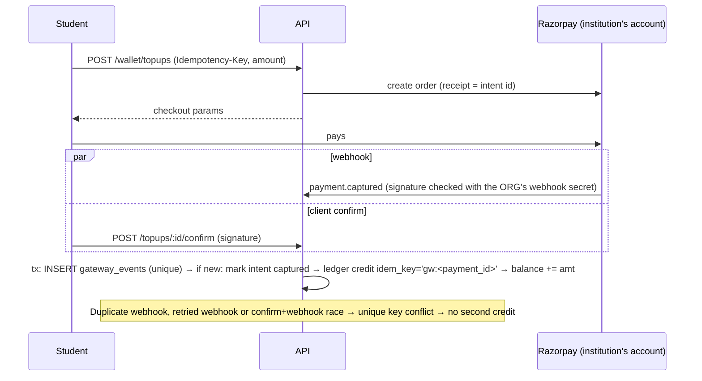

# 10 · Wallet, Payment and Offline Architecture (Education Mode)

Business Mode payments (cash, direct UPI, Razorpay per order) are **not modified** by anything below. All items **[R]**.

## 1. Principles

1. **Money only moves through an append-only ledger.** Balances are derived/cached, never edited.
2. **Hold at submit, capture at completion.** A student is not charged for a job that never printed.
3. **Every external event is idempotent** by a deterministic key.
4. **Education money tables are separate** from Business money tables.
5. **Integer minor units (paise), single currency per org, no floats.**

## 2. Ledger model

| Table | Purpose | Integrity |
|---|---|---|
| `wallet_accounts` | one per student (and optional institution revenue/clearing accounts) | unique `(org_id, owner_user_id, kind)` |
| `ledger_entries` | immutable journal lines (`amount_minor` signed) | insert-only (REVOKE UPDATE/DELETE + trigger), `UNIQUE (org_id, idem_key)` |
| `wallet_balances` | cached `available / held / reserved` | updated **in the same transaction** as the entry; `CHECK >= 0` |
| `wallet_holds` | authorisations tied to jobs | states `open → captured | released`; expiry sweeper releases orphans |
| `payment_intents` | top-up attempts (provider order id, amount, state) | `UNIQUE (provider, provider_order_id)` |
| `gateway_events` | every webhook/verify event | `UNIQUE (provider, event_id)` |
| `refunds_v2` | refunds referencing the credit entry; partial allowed | sum(refunds) ≤ original credit |

Double-entry is used between **student wallet**, **institution revenue**, **gateway clearing** and **adjustment** accounts, so `SUM(amount)` over all entries of an org is always 0 (checked nightly).

### Atomic spend (no double spending)
```sql
UPDATE wallet_balances
   SET available_minor = available_minor - $amt, held_minor = held_minor + $amt, version = version + 1
 WHERE account_id = $acc AND available_minor >= $amt
RETURNING version;           -- 0 rows ⇒ insufficient funds, nothing written
INSERT INTO ledger_entries (…, idem_key = 'hold:'||$job_id) ON CONFLICT (org_id, idem_key) DO NOTHING;
```
Both statements and the `print_jobs` insert are one transaction. Concurrent spends serialise on the balance row; the `CHECK` constraint is the final guard.

## 3. Flows

### 3.1 Top-up (online payment)

- Webhook endpoint carries an org key (`/webhook/razorpay/:org_key`) so the **correct secret** verifies it; amount, currency and `order_id` must match the intent.
- Unknown/mismatched captured payment ⇒ `gateway_events.status='orphan'`, alert to admin (never silently dropped, never auto-credited to a guessed account).
- Pay-per-job for a student is "top-up of the exact shortfall + immediate hold", so one money path exists.

### 3.2 Print authorisation and capture
| Step | Ledger effect |
|---|---|
| Submit (student) | `hold` entry: available → held (cost from pricing rule × pages × copies × colour) |
| Job `completed` | `capture`: held → revenue (amount = pages_reported-based cost, ≤ held); remainder auto-released |
| Job cancelled / failed (nothing printed) | `release`: held → available |
| `failed_partial` | capture pro-rata, release rest; operator can override with a reason (audited) |
| `uncertain` | hold stays open until the operator resolves; hold expiry is **paused** for uncertain jobs |
| Staff job | no hold; `print_jobs.payer='institution'`, usage recorded (pages, cost-equivalent) for reports |

### 3.3 Refunds
- Refund to wallet (default) or to original method (provider API, partial allowed). Both create `refunds_v2` + reversing ledger entries; **no UPDATE of earlier rows**. Gateway refund webhooks are recorded in `gateway_events` and reconcile against `refunds_v2` (fixes the Business gap where gateway refunds cannot be recorded).

### 3.4 Reconciliation
Nightly job: (a) sum of ledger = 0 per org, (b) cached balance = ledger sum per account, (c) provider settlement report vs `gateway_events` (missing/extra), (d) holds older than expiry. Differences open a `reconciliation_case` for the institution admin.

## 4. Settlement account (decision required)

Business Mode online payments are valid only in `single_merchant` mode ([01](01-existing-project-technical-audit.md) P4). For colleges, money must reach the **institution**, not the platform. Options:

| Option | Pros | Cons |
|---|---|---|
| **A. Institution's own Razorpay keys** (stored encrypted per org, per-org webhook secret) | Money never touches platform; simple compliance story | Each college must have a Razorpay account; key custody risk |
| **B. Razorpay Route / linked accounts** | Platform onboards sub-merchants | Platform becomes a marketplace; KYC, settlement and commission accounting responsibility |
| **C. Platform collects and pays out** | No college gateway needed | Platform holds third-party money ⇒ highest regulatory burden |

**Recommendation: A for launch.** **Compliance caution [A]:** a prepaid student wallet is stored value; whether it falls under RBI prepaid-instrument rules, GST invoicing, refund/expiry policy and DPDP obligations must be confirmed with a qualified advisor before launch. This is not legal advice.

## 5. Offline architecture

### 5.1 What "offline" can honestly mean
The cloud holds identities, documents, prices and balances; **if the internet is down, users cannot upload to the cloud at all.** Therefore offline printing needs one of:

| Mode | Description | Recommendation |
|---|---|---|
| **O1 – Finish what is already downloaded** | Agent has claimed/downloaded jobs; cloud drops; agent finishes and syncs later | Phase 3 (comes free with the local queue) |
| **O2 – LAN portal on the agent** | During an outage users on the campus LAN open `http://print-agent.local`, authenticate locally, upload to the agent, which prints under offline rules | Phase 7; staff first, students after |
| **O3 – Pre-fetched queue** | Agent pre-downloads queued documents | Covered by O1 |

### 5.2 Rules by population
| Who | Offline rule |
|---|---|
| **Staff** | Allowed if `policies.offline.staff = true`; no charge; usage recorded locally and synced; local per-day page cap (default 200) to bound abuse |
| **Student** | **Only against a previously created reservation.** No top-up, no card, no unlimited credit. |

### 5.3 Offline reservation (anti double-spend)
1. Online, the student reserves ₹X for offline use at a chosen agent: ledger moves `available → reserved` (entry `reserve`), creating `offline_reservations(id, agent_id, limit_minor, expires_at)`.
2. Cloud issues a **signed reservation token** (Ed25519, contains reservation id, account id, agent id, limit, expiry, nonce) and pushes it to that agent at next sync; the student also sets/receives an **offline PIN** (verifier = Argon2id hash cached on the agent only for the reservation's lifetime) since the agent cannot validate the cloud password.
3. Offline, the agent authenticates roll number + PIN against the cached verifier, checks token signature, expiry and `spent + cost ≤ limit` in its **local ledger** (`spend_log`, monotonically numbered `seq`), and prints.
4. **Double-spend prevention:** a reservation is bound to **exactly one agent**, and the cloud has already moved the money out of `available`. A second agent has no token for it; the same student can hold separate reservations per agent but total ≤ the configured cap (`max_reservation_per_student`).
5. On reconnect `POST /sync` sends `(agent_id, seq, reservation_id, job, pages, amount)`. The server inserts `reservation_spends` (PK `(agent_id, seq)` ⇒ replay-safe), posts `capture` entries, and releases any unspent remainder when the reservation expires/closes.
6. Over-limit or expired spends cannot occur locally; if an agent clock is wrong, validity is computed from monotonic elapsed time since last sync, and the server re-validates at sync (excess ⇒ `reconcile_required` charged to the institution account, not the student).
7. Limits and expiry are policies: `max_reservation_per_student`, `max_reservation_per_agent`, `expiry_hours` (default 24–72), auto-release at expiry.

### 5.4 Failure analysis
| Failure | Outcome |
|---|---|
| Agent stolen/PC reset with tokens | Tokens are agent-bound and expire; cached verifiers hashed; admin revokes agent ⇒ cloud releases unspent reservations on expiry (spent amounts are already bounded) |
| Agent offline for days | Reservation expires; no further offline spends; sync after reconnection posts what happened |
| Sync replay | `(agent_id, seq)` PK ⇒ idempotent |
| Student cancels reservation while agent offline | Cloud marks `closing`; effective only after agent sync (money remains reserved until then) |
| Job printed offline but cloud shows cancelled | `reconcile_required` case; money follows what physically printed |

## 6. Business Mode isolation

No shared tables, no shared endpoints, no change to `collect()`, `transactions`, `refunds`, `payment_events`, `/api/payments/webhook`. The Education webhook is a different route with different secrets. Regression gate: the existing cash/UPI/Razorpay tests must run unchanged in CI for every PR touching `education/`, `printing/` or `core/`.
