# 14 · Phased Implementation Roadmap

Sizing uses **S** (≤1 week), **M** (2–3 weeks), **L** (4–6 weeks) for one experienced full-stack engineer **[A]**; the user's team size and availability are unknown. Order is by risk: fix and protect the live product first, then add tenancy, then Education.

```mermaid
gantt
  dateFormat X
  axisFormat %s
  title Dependency order (not calendar dates)
  section Protect
  P0 Safety net & baseline       :p0, 0, 2
  P1 Fix critical existing issues :p1, after p0, 3
  section Foundation
  P2 Tenancy, registration, auth  :p2, after p1, 5
  P3 Agent & printer model v2     :p3, after p1, 6
  section Education
  P4 Education core (staff first) :p4, after p2, 6
  P5 Wallet & payments            :p5, after p4, 5
  P6 WFQ scheduler & release      :p6, after p4, 3
  P7 Offline modes                :p7, after p5, 5
  section Harden
  P8 Load, pentest, DR, ERP hooks :p8, after p6, 4
```

P2 and P3 can run in parallel (disjoint tables/files) once P1 is done. P5/P6 can run in parallel after P4.

> **Status (2026-11-05):** Phase 1 is implemented and deployed (commits `11960a1`, `5b19277`) and the owner-MFA date policy and lifecycle guard test are added after it. Phase 0 is done as far as the repository allows (PostgreSQL job and secret scan in CI, API contract test, census script, dev-database warning). **Needs infrastructure or your action, not code:** staging environment and deploy promotion gate, restore drill, confirming the exposed password from commit `885501f` was rotated. **Deliberately deferred:** pages-printed reporting (moves to the Phase 3 agent, where real progress is tracked) and a capability block at order creation (would stop owners who print manually).

**Standing rule for every phase:** merge only if (1) the Business regression suite is green on SQLite **and** PostgreSQL, (2) the v1 API contract snapshot is unchanged, (3) a rollback was rehearsed, (4) the change is behind an org-level feature flag until accepted.

---

## Phase 0 — Safety net and baseline (S–M)

| Field | Content |
|---|---|
| 1 Objective | Make it safe to change anything: separate environments, PostgreSQL in CI, regression and contract tests, backups proven. |
| 2 Existing dependencies | `test/*.test.js` (97 tests), `.github/workflows/ci.yml`, `render.yaml`, README dev instructions. |
| 3 Required changes | Create staging (separate Neon branch + Render service, no auto-deploy from `main` to prod without promotion); CI PostgreSQL service and run suite on both dialects; tag current 97 tests as `business-regression`; add API contract snapshot of all 88 v1 routes; add `scripts/census.sql` (read-only counts, run by owner on a snapshot); secret scan; startup guard against non-prod pointing at prod DB; restore drill. |
| 4 Database impact | None. |
| 5 API impact | None. |
| 6 Frontend impact | None. |
| 7 Agent impact | None. |
| 8 Security | Rotate anything ever exposed (project memory notes commit `885501f`); scan history; remove `.data` fixtures from the working copy backups. |
| 9 Testing | The CI matrix itself; contract test; restore test. |
| 10 Acceptance | CI green on PG; production → staging restore completed and timed; `main` no longer deploys unreviewed; census report reviewed. |
| 11 Risks | PG exposes latent SQLite-only assumptions in tests (expected; fix tests, not production). |
| 12 Rollback | Config-only; revert workflow/render settings. |

## Phase 1 — Fix critical existing problems (M)

| Field | Content |
|---|---|
| 1 Objective | Remove verified defects that threaten the live Business Mode before building on it. |
| 2 Existing dependencies | `devices.js`, `index.js` quotes/cleanup, `db.js`, `uploads.js`, `payments.js`, connector. |
| 3 Required changes | [13](13-existing-functionality-improvement-report.md) items 1–5, 9, 10, 11: persisted pause; quote-document lifecycle + quota fix; versioned migrations + owner-role deploy step + startup verification; mandatory `order_history`; capability check at order creation / owner remote print; method-flip guard; owner MFA enforcement with grace; pages-printed (additive); idle backoff in connector; sweepers for quotes/notifications/idempotency. |
| 4 Database impact | `devices.paused`, `paused_note`; `schema_migrations`; indexes (`audit(created)`, `orders(created)`, `quotes(expires)`, `print_leases(expires,state)`). All additive. |
| 5 API impact | Additive response fields only; one new optional field on device events. |
| 6 Frontend impact | Owner: pause state from server, uncertain-job card, MFA banner. |
| 7 Agent impact | Optional `pages_printed`, idle backoff; old connectors keep working. |
| 8 Security | S1, S3, S7 mitigations; audit integrity. |
| 9 Testing | New tests for each fix (quota recovery, pause persistence across app recreation, capability 409, migration apply on empty/baseline DB); full regression on PG. |
| 10 Acceptance | S1 scenario cannot exceed quota beyond live items; pause survives restart in staging; deploy refuses to start with unapplied migrations; zero change in v1 contract snapshot except additive keys. |
| 11 Risks | Migration step changes deploy procedure (document it); MFA enforcement may lock owners out → grace period, recovery codes, operator CLI exists. |
| 12 Rollback | Each fix is its own PR/flag; migrations additive (leave objects); MFA enforcement toggled by env `ENFORCE_MFA`. |

## Phase 2 — Tenancy, registration and unified authentication (L)

| Field | Content |
|---|---|
| 1 Objective | Introduce `organizations`/`memberships`, unified registration with approval workflow, e-mail service, extended sign-in – with Business behaviour unchanged. |
| 2 Existing dependencies | `users`, `shops`, `sessions`, `auth.js`, admin shop approval, `scripts/provision-admin.js`. |
| 3 Required changes | Organizations + dual-write from `/api/auth/register` and `/api/admin/shops/:id/status`; backfill shops → business orgs; memberships (owner role mirrored); registration v2 (states, e-mail verification, reject/need-info); invitation tokens; e-mail provider integration; `/api/v2/auth/login`, org picker, `/api/v2/me`; session columns; permission middleware (not yet applied to Business routes); platform reviewer console tab. |
| 4 Database impact | New: `organizations`, `memberships`, `user_identifiers`, `organization_registrations`, `invitations`, `audit_log_v2`; additive: `shops.organization_id`, `users.email` nullable, `sessions.*`. |
| 5 API impact | New `/api/v2/registrations`, `/platform/*`, `/auth/*`; v1 login adds optional `organization` fields. |
| 6 Frontend impact | Registration wizard with type selector (Business path identical outcome); admin "Registrations" tab; no Business screen changes. |
| 7 Agent impact | None. |
| 8 Security | E-mail verification, throttles, no generated passwords, platform roles with MFA, audit on every decision. |
| 9 Testing | Backfill idempotency; dual-write consistency; every v1 auth test unchanged; new tests for state machine, invitation expiry/reuse, cross-org forged ids; `/api/me` shape test. |
| 10 Acceptance | `count(shops) = count(business orgs)` and statuses equal after backfill; existing owners/admins sign in with no UI change; an education registration can be approved/rejected end to end in staging with e-mails delivered; matrix test passes. |
| 11 Risks | Dual-write drift; e-mail deliverability; email-nullable change affecting lookups (queries all use `WHERE email=$1`, safe). |
| 12 Rollback | Feature flag off hides v2 endpoints/UI; v1 paths never depended on org tables; backfilled rows are harmless; drop-forward is not required. |

## Phase 3 — Agent and printer model v2 (L)

| Field | Content |
|---|---|
| 1 Objective | Multiple agents, multiple printers per agent, per-agent credentials, long-poll claim, attempts with fencing, persistent local queue — alongside the legacy protocol. |
| 2 Existing dependencies | `connector/*`, `devices.js`, `printer-capabilities.js`, `print_leases`. |
| 3 Required changes | Tables `agents`, `agent_credentials`, `printers`, `printer_pools`, `pool_members`, `pool_access`, `print_jobs`, `print_attempts`, `queue_events`, `agent_health_events`; `/api/agent/v2/*`; agent v3 (dual protocol, service, DPAPI, local SQLite, signed updater, long-poll); health dashboard data; legacy `devices` mirrored read-only into the new tables. |
| 4 Database impact | New tables only; partial unique index on live attempts; no change to `devices`/`print_leases` semantics. |
| 5 API impact | New agent v2 routes; `/api/device/*` untouched. |
| 6 Frontend impact | Admin-only health views; Business owner Printers page unchanged. |
| 7 Agent impact | New binary; existing installs unaffected until opted in; protocol chosen by enrolment. |
| 8 Security | Credential rotation/revocation, DPAPI, signed updates, fence epochs, local bridge pairing code. |
| 9 Testing | Claim concurrency on PostgreSQL (N agents × M jobs, no double claim); fence tests; crash-recovery simulations (kill agent at each journal step); capability routing matrix; long-poll behaviour; **real printer tests on the shop PC with the user's consent and explicit test plan** (uses the printers already installed: Brother DCP-T820DW colour/duplex, HP LaserJet 1020 mono). |
| 10 Acceptance | 0 duplicate prints in 10 000 simulated claims with 5 agents; colour job never reaches a mono printer in any tested configuration; agent restart at each step yields no reprint; idle API calls per agent ≤ 4/min; legacy connector end-to-end test green. |
| 11 Risks | Installer/updater complexity; Windows service quirks; USB device flakiness (known with HP 1020 re-install as "Copy N"). |
| 12 Rollback | Auto-rollback of agent on failed heartbeat; server routes flagged; legacy protocol is the fallback for any shop. |

## Phase 4 — Education core, staff printing first (L)

| Field | Content |
|---|---|
| 1 Objective | Institutions, optional campuses/departments, users + bulk import, staff printing (no payment), operator console, retention, reports v1. |
| 2 Existing dependencies | Phases 2–3; `prepare()`/`validateOptions()`; password/MFA primitives. |
| 3 Required changes | `institution_settings`, `campuses`, `departments`, `edu_profiles`, `import_batches`, `stored_objects`, pricing rules (read-only for staff cost-equivalent), object-storage `DocumentStore`, isolated preparation worker, job submit/quote, operator queue, uncertain resolution, retention sweeper, usage reports, `public/edu/*` UI. |
| 4 Database impact | New tables + RLS policies on them; storage bucket. |
| 5 API impact | `/api/v2/edu/*` (users, imports, institution, pools, printers, jobs, queue, reports). |
| 6 Frontend impact | New lazy-loaded Education area; shared CSS tokens reused. |
| 7 Agent impact | Uses protocol 2; no further change. |
| 8 Security | Org-scoped everything, RLS, upload isolation, per-org keys, import abuse limits, support-access grants (basic). |
| 9 Testing | Scenarios A–D of [04](04-flexible-institution-configuration.md); cross-institution access suite; import dry-run/error handling; retention expiry; Business regression untouched. |
| 10 Acceptance | One-printer/no-department college operational with ≤ 5 setup actions; staff job printed on real printer end to end; forged cross-org ids always 404; documents deleted per policy within 5 minutes of expiry. |
| 11 Risks | Scope creep in reports; object-storage vendor choice; real-world roll-number data quality. |
| 12 Rollback | Org-level flag off; Education tables isolated; no Business dependency. |

## Phase 5 — Wallet and payments (L)

| Field | Content |
|---|---|
| 1 Objective | Student wallet, top-ups, holds/capture, refunds, reconciliation. |
| 2 Existing dependencies | Phase 4; Razorpay integration knowledge (Business code untouched). |
| 3 Required changes | Ledger tables, balances, holds, payment intents, gateway events, refunds_v2; per-org gateway credentials; webhook route; reconciliation job; student wallet UI; admin adjustments (two-person above limit). |
| 4 Database impact | New tables, triggers, REVOKEs; zero-sum check function. |
| 5 API impact | `/api/v2/edu/wallet/*`, `/payments/webhook/:provider/:org_key`. |
| 6 Frontend impact | Student wallet, transactions, receipts; admin wallet reports. |
| 7 Agent impact | Pages-reported used for capture. |
| 8 Security | Webhook secrets per org, insert-only ledger, atomic spends. |
| 9 Testing | Duplicate webhook, confirm+webhook race, 100 concurrent spends on one wallet (never negative), refund partial, partial print capture, reconciliation break detection; Razorpay **test mode** only. |
| 10 Acceptance | Ledger sums to zero after fuzzed workload; no double credit in 1 000 duplicated events; balance never negative under concurrency test; reconciliation flags injected mismatch. |
| 11 Risks | Regulatory classification of stored value **[A]**; settlement account choice; gateway fee handling. |
| 12 Rollback | Flag off disables top-ups; ledger is append-only so corrections are new entries, never edits. |

## Phase 6 — Fair queueing and release-at-printer (M)

| Field | Content |
|---|---|
| 1 Objective | Configurable Weighted Fair Queueing with Aging, per-user caps, optional release code at the printer. |
| 2 Existing dependencies | Phase 3 claim query and attempts; Phase 4 jobs and pools; Business FIFO scheduler stays as the `fifo_priority` option. |
| 3 Required changes | Scheduler module (virtual-time tags, aging score), `queue_classes` state, per-user queued cap, operator reprioritise within caps, release-code issue/verify, discrete-event simulation harness. |
| 4 Database impact | `queue_classes(pool_id, class, f_last)`; `print_jobs.vft`, `priority_boost`, `release_code_hash`; partial index on queued jobs by score inputs. |
| 5 API impact | `POST /jobs/:id/release`; queue endpoints return position/estimate; pool scheduler settings in `/pools`. |
| 6 Frontend impact | Queue position and ETA for users; operator reprioritise control; admin scheduler settings with a "preview effect" table. |
| 7 Agent impact | Release verification at the agent's LAN page or via cloud; no change to claim safety rules. |
| 8 Security | Release codes single-use, short-lived, rate limited; reprioritisation audited; boost capped to prevent queue jumping abuse. |
| 9 Testing | Simulation: throughput per class within ±5 % of weights over 1 000 jobs; aging bound test; per-user cap test; 200 simultaneous submits keep claim p95 < 300 ms on PostgreSQL; Business regression unchanged. |
| 10 Acceptance | No eligible job waits longer than `max_wait_target` while capacity exists; weights honoured within ±5 %; a user with 100 copies cannot delay others beyond the cap. |
| 11 Risks | Mis-tuned weights cause perceived unfairness; added scheduler state under contention. |
| 12 Rollback | Per-pool switch back to `fifo_priority` (instant, no data change); release requirement off by policy. |

## Phase 7 — Offline modes (L)

| Field | Content |
|---|---|
| 1 Objective | O1 finish-what-is-downloaded (delivered with the Phase 3 local queue), O2 LAN portal for staff first, then student offline reservations. |
| 2 Existing dependencies | Phase 3 agent (local SQLite queue, journal, fencing), Phase 5 ledger and holds, Phase 4 policies. |
| 3 Required changes | Agent outbox and `POST /sync`, reservation issue/close, signed reservation tokens, local PIN verifier cache, LAN portal (HTTPS with pairing), local spend log with monotonic sequence numbers, reconciliation case handling. |
| 4 Database impact | `offline_reservations`, `reservation_spends` (PK `(agent_id, seq)`), `sync_batches`, `reconciliation_cases`; ledger entry kinds `reserve`/`reservation_capture`/`reservation_release`. |
| 5 API impact | `/wallet/reservations`, `/agent/v2/sync`, admin offline policy endpoints. |
| 6 Frontend impact | Student "reserve for offline use" screen; admin policy and reconciliation views; operator view of offline-printed jobs. |
| 7 Agent impact | LAN portal, offline authentication against cached verifiers, local limit enforcement, encrypted store, replay-safe sync client. |
| 8 Security | Agent-bound tokens, expiry using elapsed monotonic time, PIN verifiers hashed (Argon2id) and removed on expiry, bounded daily caps, tamper-evident local log. |
| 9 Testing | Cut the WAN for hours on the real shop PC (with consent); double-spend attempts across two agents; replayed and out-of-order sync batches; clock skew; agent crash mid-spend; reservation cancelled while offline. |
| 10 Acceptance | Offline spend never exceeds the reservation in any run; replay has no effect; after reconnection ledger equals the local spend log; expiry releases the remainder exactly once. |
| 11 Risks | Highest complexity and financial edge cases; LAN portal expands the attack surface; user expectation of "offline" differs from what is feasible. |
| 12 Rollback | Policy flag disables the LAN portal and new reservations; existing reservations expire; staff-only mode can ship first and stay. |

## Phase 8 — Hardening, operations and integrations (M)

| Field | Content |
|---|---|
| 1 Objective | Prove the platform under load and failure, close security findings, finish operations and integration hooks. |
| 2 Existing dependencies | Phases 0–7 complete; monitoring stack chosen. |
| 3 Required changes | k6 load suites, external penetration test and fixes, DR/restore and key-custody drills, central logging/metrics/alerts, support-access workflow UI, outbound webhooks and import API for ERP/college systems, accessibility and localisation review, runbooks. |
| 4 Database impact | Partitioning of `audit_log_v2`/`queue_events`, retention jobs, read-replica role and reporting views. |
| 5 API impact | Webhook subscription endpoints, signed event payloads, import/sync endpoints; OpenAPI published. |
| 6 Frontend impact | Admin health dashboards, grant approval screen, accessibility fixes. |
| 7 Agent impact | Canary/stable channels exercised in production; update-signature rotation procedure. |
| 8 Security | Pen-test highs closed; secrets rotation drill; verify platform roles cannot read documents; CSP unification. |
| 9 Testing | Targets in [15](15-testing-and-acceptance-criteria.md) §6; chaos tests for alerts; restore timing. |
| 10 Acceptance | All §6 numbers met; RPO ≤ 15 min and RTO ≤ 2 h demonstrated; zero open high findings; alerts fire within 2 min in drills. |
| 11 Risks | Findings late in the schedule; cost of monitoring and pen-test; integration scope creep. |
| 12 Rollback | Nothing here changes core behaviour; each item is configuration or additive; webhooks can be disabled per organization. |

## Cross-phase dependency table

| Needs → | P0 | P1 | P2 | P3 | P4 | P5 | P6 | P7 |
|---|---|---|---|---|---|---|---|---|
| P1 | ● | | | | | | | |
| P2 | ● | ● | | | | | | |
| P3 | ● | ● | | | | | | |
| P4 | ● | ● | ● | ● | | | | |
| P5 | | | | | ● | | | |
| P6 | | | | ● | ● | | | |
| P7 | | | | ● | ● | ● | | |
