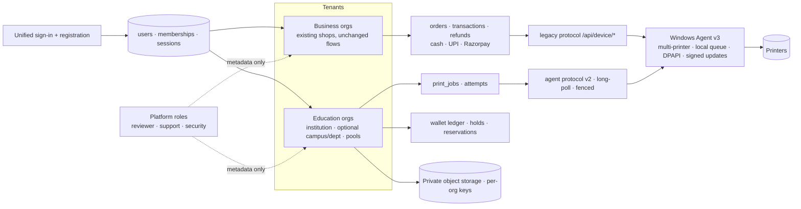

# 17 · Final Recommended Architecture

## 1. Summary

Keep the working Express/PostgreSQL product. Make `organizations` the tenant root, wrap every existing shop in a business organization (1:1, additive), add Education as a second organization type with its own tables for jobs and money, and replace the one-printer "connector" with a multi-printer, multi-agent Windows Agent that speaks the legacy protocol (Business) and a new fenced protocol (Education). Structure the code as a modular monolith with enforced boundaries. Fix the verified defects in the live product **first**.

## 2. Decisions and their reasons

| # | Decision | Reason |
|---|---|---|
| D1 | Modular monolith, no microservices | Wallet+queue need single-transaction atomicity; small team; seams preserved ([12](12-scalability-and-extensibility-strategy.md) §8) |
| D2 | `organizations` as tenant root; `type` immutable | Business and Education differ in roles, money, workflows; a flag on `shops` would entangle them |
| D3 | Memberships, not new `users.role` values | A person may belong to several orgs; roles differ per org type; Business `owner/admin` untouched |
| D4 | New tables for Education jobs and money; never reuse `orders`/`transactions` | Business invariants (`payment='paid'` gating, one transaction per order, one full refund) do not fit wallets/partial prints |
| D5 | Pools between people and printers | One schema serves 1-printer and multi-campus institutions; departments optional |
| D6 | Agent ≠ printer; USB printers bound to one agent; network printers multi-agent with fencing | Matches physical reality; prevents "disconnected agent's USB printer used by another agent" |
| D7 | `SKIP LOCKED` + partial unique live-attempt index + fence epochs + journal-before-submit | Layered guarantees against double printing; uncertain ≠ retry |
| D8 | Hold at submit, capture at completion, pro-rata for partial | Fair billing; ties to pages reported by agent |
| D9 | Immutable double-entry ledger, per-org gateway keys | Auditability; money reaches the institution |
| D10 | Offline = finish-downloaded + LAN portal; students only against single-agent-bound reservations | Honest about what offline can mean; no double spend by construction |
| D11 | WFQ with aging, per-user caps, per-pool selectable scheduler (legacy FIFO retained) | Configurable fairness without touching Business ordering |
| D12 | Education documents in private object storage with per-org DEKs (crypto-shredding); Business keeps BYTEA | Volume, retention and secure deletion; zero risk to Business data |
| D13 | Postgres-only for new code, CI on Postgres, versioned migrations | Required for RLS, SKIP LOCKED, timestamptz; ends silent DDL failures |
| D14 | Super Admin cannot read documents/wallets without an approved, time-limited, audited grant | Requirement; enforced by key access, not UI |
| D15 | Frontend stays vanilla; Education area lazy-loaded | No benefit from a rewrite; protects Business UI |
| D16 | Business fixes (P0/P1) precede any Education table | The new work depends on safe migrations, persisted printer state and staging |

## 3. Independent expert recommendations (where this plan departs from or adds to the brief)

| # | Brief said | Weakness | Recommendation | Trade-off / impact |
|---|---|---|---|---|
| X1 | "Offline printing" with student reserved credits | Offline users cannot upload to a cloud that is unreachable; password cannot be verified offline | Define offline as O1 (finish downloaded) + O2 (LAN portal on agent) with reservation-bound tokens and a local PIN; ship staff first | More agent complexity; far fewer financial edge cases |
| X2 | Online payment for students | Pay-per-job card flows multiply reconciliation paths | Top-up then debit; one money path | One extra UI step (hidden by "pay shortfall") |
| X3 | Unified entry | Student IDs are not globally unique | Institution code / deep link `/i/<slug>` + ID; e-mail login for others | Slightly more input for students |
| X4 | Super Admin manages approvals/operations | Single all-powerful role is a data-protection liability | Split platform roles; no decrypt capability | More roles to administer |
| X5 | Printer release | Unattended printouts and wasted pages are the usual campus complaint | Optional **release at printer** (code/QR) per policy | Extra step for users; reduces waste and privacy incidents |
| X6 | Weighted Fair Queueing | Class fairness alone lets one user hog a class | Add per-user caps + round-robin tie-break | Slightly more scheduler state |
| X7 | Multiple Agents | Config fragility for non-technical college staff | Enrolment codes, tray app, health dashboard, signed auto-update, single executable | Build and signing effort (certificate cost) |
| X8 | Payment integration unchanged | Business online mode settles to a single platform merchant account and cannot record gateway refunds | Leave as is (user's instruction) but document; Education uses per-org gateways | Business online remains limited until separately approved |
| X9 | Retention configurable | Backups defeat DELETE | Crypto-shredding with per-org keys | Key management discipline required |
| X10 | Flexible config | JSON blobs become unqueryable | Typed tables for anything queried (pools, access, pricing); JSON only for validated policies | A few more tables |
| X11 | Staff "unlimited" printing | Unlimited invites abuse and untracked cost | Always record usage; optional department soft quotas and alerts | Policy decision for institutions |
| X12 | Business Mode protected | The riskiest threat is process, not code (auto-deploy to prod, dev DB = prod DB) | Phase 0 staging + promotion gate | One-time setup effort |

## 4. Missing requirements and decisions the brief did not cover

1. E-mail/SMS delivery (verification, reset, invitations, receipts) – nothing exists today.
2. Legal/financial: prepaid wallet classification, GST invoices, refund/expiry policy, DPDP Act notices and processor agreement, minors, data residency. **[A – needs a qualified advisor]**
3. Who operates the Windows agent PC at a college, uptime/UPS, support SLA.
4. Student offboarding and wallet balance payout.
5. Document types for students (Office conversion needs the isolated LibreOffice/ClamAV processor in the cloud for Education, not only on a shop PC).
6. Accessibility and localisation (Hindi/regional languages) of the student UI.
7. Support model for Super Admin: tickets, access grants, impersonation (recommended: none).
8. Sizing targets (§12 of [12](12-scalability-and-extensibility-strategy.md) are assumptions).
9. Reporting needs of colleges (cost centres, per-department chargeback, exports).
10. SSO/ERP timing.

## 5. Unresolved decisions (need your answer before Phase 2/4/5)

| # | Decision | Options | My recommendation |
|---|---|---|---|
| 1 | E-mail provider | SES / Resend / SMTP of a domain you own | Resend or SES, with a sending domain you control |
| 2 | Object storage vendor/region | S3 / Cloudflare R2 / GCS (India region) | Provider in an Indian region if data-residency matters |
| 3 | Education gateway model | A own keys / B Route / C platform collects | **A** |
| 4 | Release-at-printer | off / optional / required | optional, default off |
| 5 | Student offline scope | none / reservation + LAN portal | defer; staff offline first |
| 6 | Hosting plan | stay on free tiers / paid always-on | paid web + worker; remove idle polling first |
| 7 | KMS | cloud KMS / self-managed Vault / app-level KEK only | cloud KMS |
| 8 | Agent distribution | keep Node + bat / signed single exe | signed single exe (needs code-signing certificate) |
| 9 | Staff quota policy | unlimited / soft quotas | unlimited with usage alerts |
| 10 | Pilot institution and its printer topology | unknown | choose a one-printer college first |
| 11 | Platform role split now or later | single admin / split | split at Phase 2 |
| 12 | Whether to migrate Business jobs onto the new attempt model | never / later | later, only after Education is stable |

## 6. What is recommended to approve first

Approve **Phase 0 and Phase 1 only**: staging, PostgreSQL CI, regression/contract tests, versioned migrations, persisted printer state, quota-DoS fix, owner MFA enforcement. They reduce risk to the live business regardless of what happens with Education, and every later phase depends on them.
