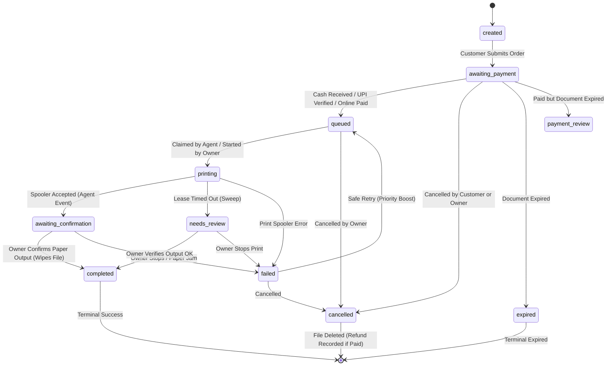

# SmartPrint — Order State Machine Specification

## 1. State Machine Overview

The SmartPrint fulfillment lifecycle separates **Payment Status** (`payment`) from **Order Fulfillment Status** (`status`). An order cannot transition to printing unless it is in a verified paid state (`payment = 'paid'`). Every state transition must be validated by the centralized state machine service before any database modification.

---

## 2. Status Definitions

### Payment Statuses (`orders.payment`)
- `pending`: Awaiting payment confirmation (cash or direct UPI).
- `paid`: Payment collected and verified (cash received by owner, UPI reference verified, or gateway webhook captured).
- `refunded`: Money returned to customer for unfulfilled or cancelled print order.

### Order Fulfillment Statuses (`orders.status`)
- `created`: Initial order record created from valid quote.
- `awaiting_payment`: Customer order submitted; awaiting payment at counter or UPI confirmation.
- `queued`: Order is paid and ready in queue for automatic or manual print processing.
- `printing`: Order claimed by Windows Print Agent lease or manually opened by owner for printing.
- `awaiting_confirmation`: Print document accepted by local Windows print spooler; waiting for owner to verify physical paper in printer tray.
- `completed`: Terminal success. Owner confirmed paper output; live encrypted document permanently purged from storage.
- `needs_review`: Printer lease timed out, printer went offline mid-job, or spooler reported uncertain state. Requires shop owner inspection.
- `payment_review`: Payment was collected, but document expired or became unavailable. Requires shop assistance.
- `failed`: Job explicitly marked failed or stopped by shop owner. Document retained for retry or refund.
- `cancelled`: Order cancelled before printing or after failed fulfillment. Document purged.
- `expired`: Document expired before payment or completion.

---

## 3. Transition Matrix & Permitted Actors

| Current Status | Target Status | Required Payment | Allowed Actors | Trigger / Action | Side Effects |
| :--- | :--- | :--- | :--- | :--- | :--- |
| `created` | `awaiting_payment` | `pending` | Customer | Order created via `/api/orders` | Record quote used; assign receipt token |
| `awaiting_payment` | `queued` | `pending` -> `paid` | Shop Owner | Collect Cash (`/api/owner/orders/:id/cash`) | Insert into `transactions`; log audit |
| `awaiting_payment` | `queued` | `pending` -> `paid` | Shop Owner | Verify UPI (`/api/owner/orders/:id/upi-confirm`) | Insert into `transactions`; check duplicate UPI ref |
| `awaiting_payment` | `queued` | `pending` -> `paid` | System (Webhook)| Razorpay webhook (`payment.captured`) | Insert into `transactions`; log audit |
| `awaiting_payment` | `payment_review` | `pending` -> `paid` | Owner / Webhook | Payment arrived but document expired | Insert transaction; alert owner |
| `awaiting_payment` | `cancelled` | `pending` | Customer / Owner| Cancel order (`/api/owner/orders/:id/cancel`) | Purge document; release quote |
| `awaiting_payment` | `expired` | `pending` | System (Cleanup) | File expired (`cleanup()`) | Update status; delete document |
| `queued` | `printing` | `paid` | Print Agent | Claim job lease (`/api/device/claim`) | Insert into `print_leases`; set lease timeout |
| `queued` | `printing` | `paid` | Shop Owner | Manual print (`/api/owner/orders/:id/start`) | Log audit; prepare document stream |
| `queued` | `cancelled` | `paid` | Shop Owner | Owner cancels queued job | Purge document; mark for refund |
| `printing` | `awaiting_confirmation` | `paid` | Print Agent | Spooler accepted (`event: awaiting_confirmation`)| Update lease state; notify owner |
| `printing` | `needs_review` | `paid` | System (Sweep) | Lease expired without event (`sweepLeases`) | Mark lease uncertain; alert owner |
| `printing` | `failed` | `paid` | Print Agent | Spooler submission error (`event: failed`) | Release lease; alert owner |
| `awaiting_confirmation` | `completed` | `paid` | Shop Owner | Physical confirmation (`/api/owner/orders/:id/complete`)| Delete document; delete lease; terminal state |
| `awaiting_confirmation` | `failed` | `paid` | Shop Owner | Owner confirms paper jam/defect | Release lease; file retained |
| `needs_review` | `completed` | `paid` | Shop Owner | Owner inspected output and confirmed good | Delete document; delete lease; terminal state |
| `needs_review` | `failed` | `paid` | Shop Owner | Owner stopped job (`resolve-failed`) | Release lease; file retained |
| `failed` | `queued` | `paid` | Shop Owner | Owner retries job (`/api/owner/orders/:id/retry`) | Re-queue order; boost priority; clear lease |
| `failed` | `cancelled` | `paid` | Shop Owner | Owner cancels failed order | Delete document; enable refund |
| `cancelled` / `failed` | `cancelled` | `paid` -> `refunded`| Shop Owner | Record refund (`/api/owner/orders/:id/refund`) | Insert into `refunds`; log audit |

---

## 4. State Transition Diagram

---

## 5. State Machine Invariants & Integrity Rules

1. **Physical Output Integrity Rule:** An order CANNOT transition to `completed` automatically from a background worker, network webhook, or spooler response. ONLY an explicit human confirmation by the shop owner inspecting physical paper output can mark an order `completed`.
2. **Payment Integrity Rule:** An order CANNOT transition to `queued` or `printing` without a verified payment record (`orders.payment = 'paid'`).
3. **No Phantom Re-Prints:** Once an order is in `awaiting_confirmation`, `needs_review`, or `completed`, the Print Agent cannot claim it again.
4. **Idempotent Transitions:** Re-submitting an already processed transition returns the existing status without side effects.
5. **Traceable History:** Every valid state transition records an entry in `order_history` with actor, action, timestamps, and previous state.
