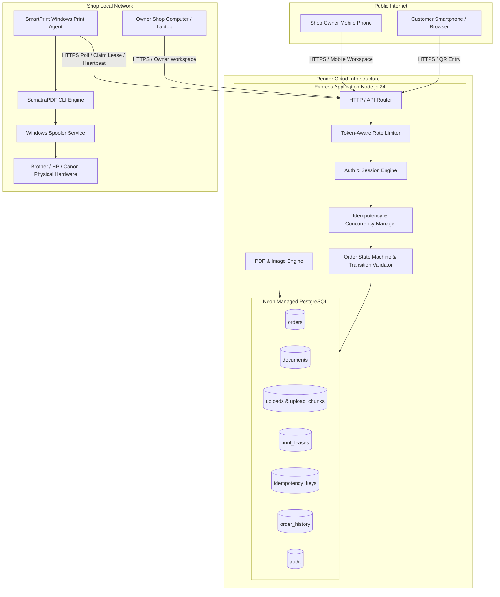

# SmartPrint — System Architecture & Integration Model

## 1. System Architecture Overview

SmartPrint is designed with clean architectural boundaries separating the public web interface, the cloud application backend, the encrypted persistence tier, and the physical shop hardware.



---

## 2. Core Subsystems

### A. Customer Flow Subsystem
- **Zero-Friction Access:** No customer account or registration required. Access is scoped strictly through a unique, unguessable shop slug (`/?shop=<slug>`) followed by cryptographically random order tokens (`receipt = token()`).
- **Client-Side Source Preview:** Uses native browser PDF.js and Image rendering directly from the user's selected file without waiting for remote server round-trips.
- **Progressive Chunked Upload:** Files are divided into 1 MB chunks, base64-encoded, and sent via PUT requests to `/api/uploads/:id/chunks/:part`. Each chunk is encrypted using AES-256-GCM before writing to the database.

### B. Pricing & Quote Subsystem
- **Authoritative Server-Side Pricing:** Pricing is strictly computed on the server based on validated page counts, layout options, copies, and shop price versioning. Clients cannot tamper with pricing.
- **Fast Repricing:** When copies or single/duplex modes change, `/api/quotes/:id/reprice` adjusts pricing in < 5ms without re-uploading or re-rendering source documents.

### C. State Machine & Idempotency Subsystem
- Centralized in `server/state-machine.js`. Every status transition is explicitly validated against a permitted transition matrix.
- `idempotency_keys` table guarantees that replayed submissions (e.g., duplicate clicks, network retries) safely return the original successful response without re-executing state transitions or generating duplicate transactions.

### D. Windows Print Agent Subsystem
- **Architecture:** Decoupled client application located in `connector/index.js` running natively on the shop's Windows PC.
- **Authentication:** Authenticates to `/api/device/*` via a hashed pairing token stored in `%LOCALAPPDATA%\SmartPrintConnector\settings.json`.
- **Durable Leases:** Claims jobs using atomic database transactions (`print_leases`). Leases have short expiry windows (180s) and automatic recovery if a connector process crashes.
- **Submission Engine:** Uses portable `SumatraPDF.exe` for reliable command-line printing (`-print-to <printer> -print-settings <options> -silent <file>`). SumatraPDF automatically translates paper format, duplexing, and color mode to Windows printer driver capabilities.

---

## 3. Data Storage & Encryption Architecture

1. **Document Encryption:**
   - Key: 256-bit symmetric key (`FILE_ENCRYPTION_KEY`).
   - Cipher: AES-256-GCM with fresh 12-byte initialization vectors (IV) and 16-byte authentication tags per chunk/document.
   - Storage: Encrypted payloads stored in `payload BYTEA` column.

2. **Zero-Retention Life Cycle:**
   - Active print documents are permanently deleted from database tables immediately upon confirmed physical output or upon order cancellation.
   - Unordered temporary uploads expire automatically within 30 minutes; background cleanup sweeps delete expired records every 60 seconds.

---

## 4. Concurrency & Multi-Device Isolation

1. **Shop Tenant Isolation:**
   - All orders, transactions, documents, and devices are strictly scoped by `shop_id`.
   - Database queries enforce shop ownership verification (`WHERE shop_id=$1 AND owner_id=$2`).
   - Cross-tenant data access is impossible at both database constraint and API layers.

2. **Mobile & Laptop Co-existence:**
   - An owner can view the dashboard on their phone and their counter laptop simultaneously.
   - Atomic conditional SQL updates prevent concurrent approval conflicts:
     ```sql
     UPDATE orders SET payment='paid', status='queued'
     WHERE id=$1 AND status='awaiting_payment' AND payment='pending'
     RETURNING id;
     ```
   - Only the first request succeeds; concurrent requests receive safe idempotent outcomes.
